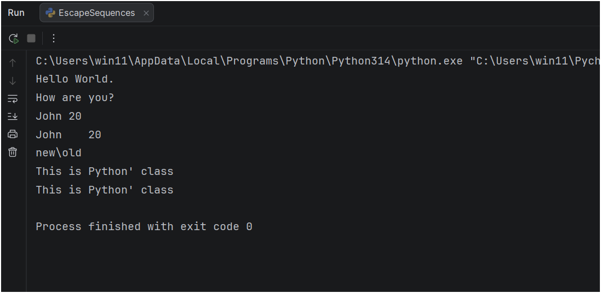

## Python Practice Question – Escape Sequences

This folder contains a Python program that solves a **basic practice question** using string manipulation and escape sequences.

It is intended for beginners to strengthen their understanding of **core Python fundamentals** through simple problem-solving.

---

## 📌 Program Overview

The program in this folder covers the following practice concepts:

- Formatting console output using **escape sequences** in string literals.
- Understanding how to embed special characters within strings without causing syntax errors.

The program executes predefined string outputs using different escape sequences and displays the results clearly in the console.

---

## 🧪 Code Functionality

The program demonstrates:

### Escape Sequences
- **Newline (`\n`)**: Inserts a line break to move the following text to the next line.
- **Tab (`\t`)**: Inserts a horizontal tab space.
- **Backslash (`\\`)**: Allows printing a literal backslash character (resolving syntax errors like `\old`).
- **Single Quote (`\'`)**: Inserts a single quote character inside a string enclosed by single quotes, preventing the string from terminating prematurely.

### String Formatting
- Differentiating between single (`'...'`) and double (`"..."`) quotes for string boundaries.
- Demonstrating that escape sequences are interpreted within standard output `print()` functions.

The program is written in a **simple and readable format**.

---

## 🖥️ Output

The program prints the formatted text directly to the console during execution.  
The complete console output for this practice question is shown below.

---

## 📂 File Information

- `EscapeSequences.py` — Contains the practice question program  
- `Output.png` — Screenshot of console output  
- `README.md` — Folder documentation  

---
## 👨‍💻 Author

**MD Shahnawaz Noor**     
*Aspiring Data Scientist* 
   
GitHub: [https://github.com/shahnawaznoor2020-code](https://github.com/shahnawaznoor2020-code)             
Email: shahnawaznoor2020@gmaIl.com  
 
---

## ⭐ Note

These practice programs help build a strong foundation in Python.  
They are essential before moving to conditions, loops, and advanced logic.
