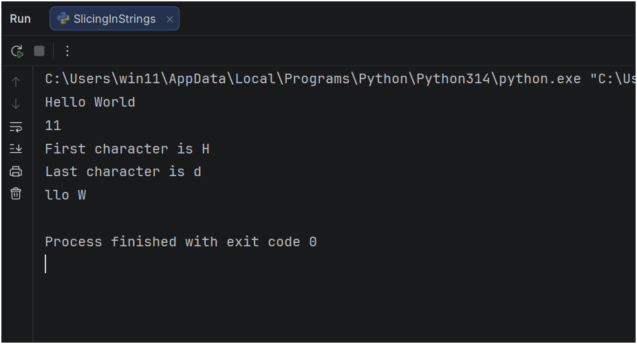

## Python Practice Question – Slicing in Strings

This folder contains a Python program that solves a **basic practice question** using string manipulation, indexing, and slicing.

It is intended for beginners to strengthen their understanding of **core Python fundamentals** through simple problem-solving.

---

## 📌 Program Overview

The program in this folder covers the following practice concepts:

- Finding the **length of a string**.
- Accessing individual characters in a string using **positive and negative indexing**.
- Extracting a substring using **string slicing**.

The program executes predefined string operations and displays the results clearly in the console.

---

## 🧪 Code Functionality

The program demonstrates:

### String Operations
- **Length (`len()`)**: Returns the total number of characters in the string.

### Indexing
- **Positive Indexing (`s1[0]`)**: Accesses the first character of the string (starting from index 0).
- **Negative Indexing (`s1[-1]`)**: Accesses the last character of the string (counting backward from the end).

### Slicing
- **Slicing (`s1[start:end:step]`)**: Extracts a portion of the string based on defined start, end (exclusive), and step values.

The program is written in a **simple and readable format**.

---

## 🖥️ Output

The program prints the evaluated string properties directly to the console during execution.  
The complete console output for this practice question is shown below.

---

## 📂 File Information

- `SlicingInStrings.py` — Contains the practice question program  
- `Output.png` — Screenshot of console output  
- `README.md` — Folder documentation  

---
## 👨‍💻 Author

**MD Shahnawaz Noor**     
*Aspiring Data Scientist* 
   
GitHub: [https://github.com/shahnawaznoor2020-code](https://github.com/shahnawaznoor2020-code)             
Email: shahnawaznoor2020@gmaIl.com  
 
---

## ⭐ Note

These practice programs help build a strong foundation in Python.  
They are essential before moving to conditions, loops, and advanced logic.
