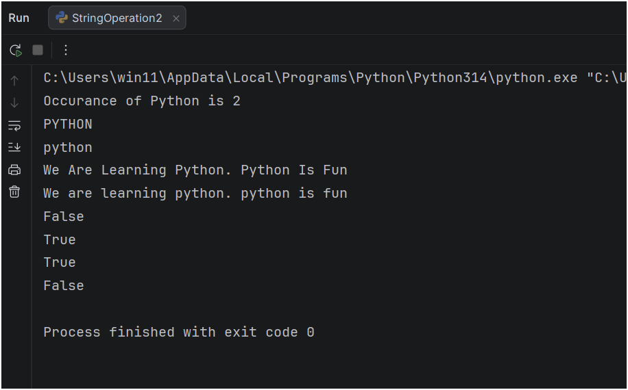

## Python Practice Question – Advanced String Operations

This folder contains a Python program that solves a **basic practice question** using string searching, case conversion, and validation methods.

It is intended for beginners to strengthen their understanding of **core Python fundamentals** through simple problem-solving.

---

## 📌 Program Overview

The program in this folder covers the following practice concepts:

- Counting the occurrences of a substring within a larger string.
- Changing the case of strings (uppercase, lowercase, title case, and capitalize).
- Checking if a string starts or ends with a specific substring.

The program executes predefined string operations and displays the results clearly in the console.

---

## 🧪 Code Functionality

The program demonstrates:

### String Counting
- **`count()`**: Returns the number of non-overlapping occurrences of a substring within the given string.

### Case Conversion
- **`upper()`**: Converts all characters in the string to uppercase.
- **`lower()`**: Converts all characters in the string to lowercase.
- **`title()`**: Converts the first character of each word to uppercase.
- **`capitalize()`**: Converts the first character of the string to uppercase and the rest to lowercase.

### String Validation
- **`startswith()`**: Returns `True` if the string starts with the specified prefix, otherwise `False` (case-sensitive).
- **`endswith()`**: Returns `True` if the string ends with the specified suffix, otherwise `False` (case-sensitive).

The program is written in a **simple and readable format**.

---

## 🖥️ Output

The program prints the evaluated string operations directly to the console during execution.  
The complete console output for this practice question is shown below.

---

## 📂 File Information

- `StringOperation2.py` — Contains the practice question program  
- `img.png` — Screenshot of console output  
- `README.md` — Folder documentation  

---
## 👨‍💻 Author

**MD Shahnawaz Noor**     
*Aspiring Data Scientist* 
   
GitHub: [https://github.com/shahnawaznoor2020-code](https://github.com/shahnawaznoor2020-code)             
Email: shahnawaznoor2020@gmaIl.com  
 
---

## ⭐ Note

These practice programs help build a strong foundation in Python.  
They are essential before moving to conditions, loops, and advanced logic.
