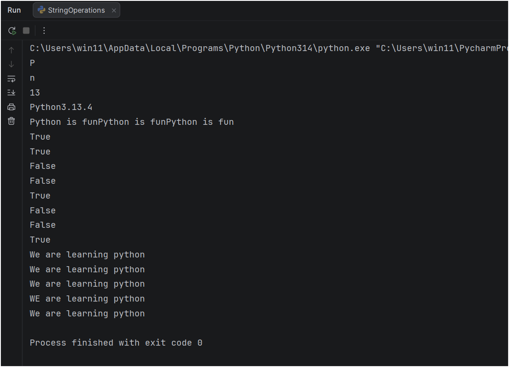

## Python Practice Question – String Operations

This folder contains a Python program that solves a **basic practice question** using string manipulation, slicing, and string methods.

It is intended for beginners to strengthen their understanding of **core Python fundamentals** through simple problem-solving.

---

## 📌 Program Overview

The program in this folder covers the following practice concepts:

- String indexing, slicing, and finding string length.
- String concatenation and repetition.
- Utilizing string membership and comparison operators.
- Employing built-in string methods like `strip()` and `replace()`.

The program executes predefined string operations and displays the results clearly in the console.

---

## 🧪 Code Functionality

The program demonstrates:

### String Indexing and Length
- **Indexing**: Accessing characters via `s1[0]` and `s1[-1]`.
- **Length (`len()`)**: Returning the total number of characters.

### String Operators
- **Concatenation (`+`)**: Joining two strings together.
- **Repetition (`*`)**: Repeating a string multiple times.
- **Membership (`in`, `not in`)**: Checking if a substring exists within a string.
- **Comparison (`==`)**: Checking for exact string equality (case-sensitive and space-sensitive).

### Built-in String Methods
- **`strip()`**: Removing leading and trailing whitespace.
- **`replace(old, new, count)`**: Replacing occurrences of a substring with another string, with an optional limit.

The program is written in a **simple and readable format**.

---

## 🖥️ Output

The program prints the evaluated string operations directly to the console during execution.  
The complete console output for this practice question is shown below.

---

## 📂 File Information

- `StringOperations.py` — Contains the practice question program  
- `Output.png` — Screenshot of console output  
- `README.md` — Folder documentation  

---
## 👨‍💻 Author

**MD Shahnawaz Noor**     
*Aspiring Data Scientist* 
   
GitHub: [https://github.com/shahnawaznoor2020-code](https://github.com/shahnawaznoor2020-code)             
Email: shahnawaznoor2020@gmaIl.com  
 
---

## ⭐ Note

These practice programs help build a strong foundation in Python.  
They are essential before moving to conditions, loops, and advanced logic.
