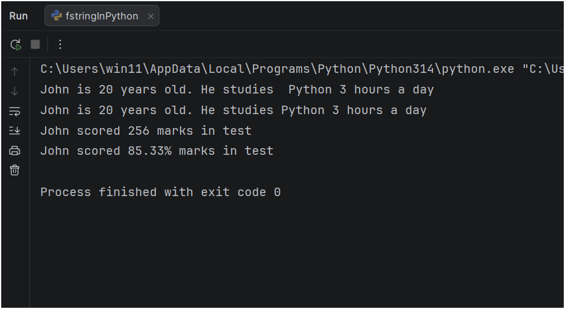

## Python Practice Question – F-Strings (Formatted String Literals)

This folder contains a Python program that solves a **basic practice question** using string formatting, specifically focusing on f-strings.

It is intended for beginners to strengthen their understanding of **core Python fundamentals** through simple problem-solving.

---

## 📌 Program Overview

The program in this folder covers the following practice concepts:

- Displaying variables alongside text using standard `print()` concatenation.
- Formatting output efficiently using **f-strings (`f"..."`)**.
- Embedding expressions and mathematical operations directly within f-strings.
- Rounding floating-point numbers within a formatted string.

The program executes predefined string outputs using different formatting techniques and displays the results clearly in the console.

---

## 🧪 Code Functionality

The program demonstrates:

### String Formatting Techniques
- **Standard Print Concatenation**: Passing multiple arguments separated by commas to the `print()` function (e.g., `print(name, "is", age, ...)`).
- **F-Strings (Formatted String Literals)**: Prefixing the string with `f` and inserting variables or expressions inside curly braces `{}`.

### Embedded Expressions
- **Variable Insertion**: Directly substituting variables like `{name}` and `{language}`.
- **Arithmetic Evaluation**: Performing calculations inline, such as `{sub1+sub2+sub3}`.
- **Function Calling**: Executing built-in functions inside the f-string, like `{round(percentage,2)}` to display a percentage up to two decimal places.

The program is written in a **simple and readable format**.

---

## 🖥️ Output

The program prints the formatted text directly to the console during execution.  
The complete console output for this practice question is shown below.

---

## 📂 File Information

- `fstringInPython.py` — Contains the practice question program  
- `Output.png` — Screenshot of console output  
- `README.md` — Folder documentation  

---
## 👨‍💻 Author

**MD Shahnawaz Noor**     
*Aspiring Data Scientist* 
   
GitHub: [https://github.com/shahnawaznoor2020-code](https://github.com/shahnawaznoor2020-code)             
Email: shahnawaznoor2020@gmaIl.com  
 
---

## ⭐ Note

These practice programs help build a strong foundation in Python.  
They are essential before moving to conditions, loops, and advanced logic.
