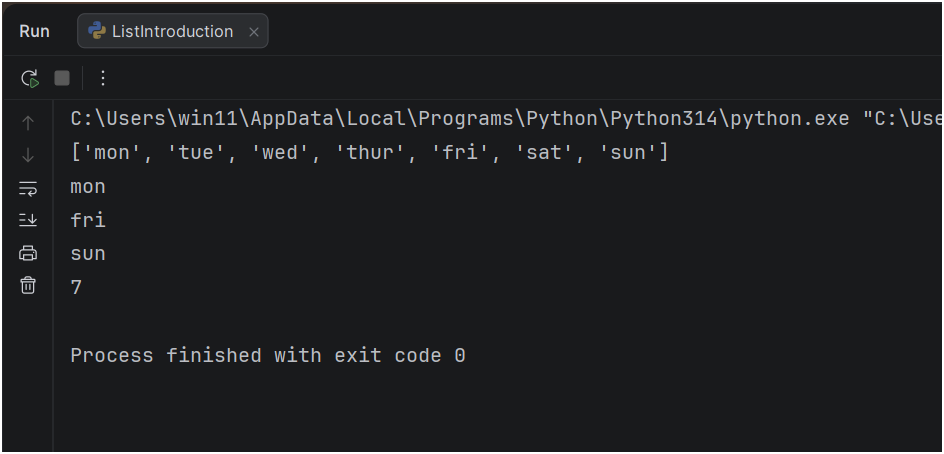

## Python Practice Question – Introduction to Lists

This folder contains a Python program that solves a **basic practice question** using list creation, indexing, and finding list length.

It is intended for beginners to strengthen their understanding of **core Python fundamentals** through simple problem-solving.

---

## 📌 Program Overview

The program in this folder covers the following practice concepts:

- Creating a list of strings representing days of the week.
- Accessing specific elements in the list using **positive and negative indexing**.
- Finding the total number of elements in the list.

The program executes predefined list operations and displays the results clearly in the console.

---

## 🧪 Code Functionality

The program demonstrates:

### List Operations
- **Creation**: Initializing a list with multiple string elements (`[...]`).
- **Length (`len()`)**: Returning the total number of items in the list.

### Indexing
- **Positive Indexing**: Accessing the first (`[0]`) and fifth (`[4]`) elements of the list.
- **Negative Indexing**: Accessing the last element (`[-1]`) from the end of the list.

The program is written in a **simple and readable format**.

---

## 🖥️ Output

The program prints the evaluated list operations directly to the console during execution.  
The complete console output for this practice question is shown below.

---

## 📂 File Information

- `ListIntroduction.py` — Contains the practice question program  
- `Output.png` — Screenshot of console output  
- `README.md` — Folder documentation  

---
## 👨‍💻 Author

**MD Shahnawaz Noor**     
*Aspiring Data Scientist* 
   
GitHub: [https://github.com/shahnawaznoor2020-code](https://github.com/shahnawaznoor2020-code)             
Email: shahnawaznoor2020@gmaIl.com  
 
---

## ⭐ Note

These practice programs help build a strong foundation in Python.  
They are essential before moving to conditions, loops, and advanced logic.
