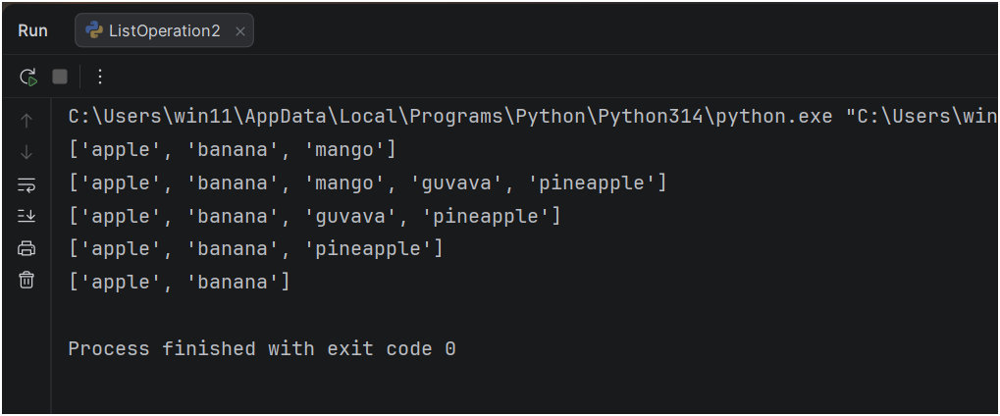

## Python Practice Question – More List Operations

This folder contains a Python program that solves a **basic practice question** using list modification methods like extending, removing, and popping elements.

It is intended for beginners to strengthen their understanding of **core Python fundamentals** through simple problem-solving.

---

## 📌 Program Overview

The program in this folder covers the following practice concepts:

- Adding multiple elements to the end of a list simultaneously.
- Removing specific elements by value from a list.
- Removing and returning elements from specific index positions or the end of a list.

The program executes predefined list operations and displays the dynamically changing list in the console.

---

## 🧪 Code Functionality

The program demonstrates:

### Adding Elements
- **`extend(iterable)`**: Appends multiple elements from another iterable (like a list) to the end of the current list.

### Removing Elements
- **`remove(value)`**: Searches for the first occurrence of a specified value and removes it from the list.
- **`pop(index)`**: Removes and returns the element at a specified index. If no index is provided, its default behavior is to remove and return the last element in the list.

The program is written in a **simple and readable format**.

---

## 🖥️ Output

The program prints the evaluated list operations directly to the console during execution.  
The complete console output for this practice question is shown below.

---

## 📂 File Information

- `ListOperation2.py` — Contains the practice question program  
- `Output.png` — Screenshot of console output  
- `README.md` — Folder documentation  

---
## 👨‍💻 Author

**MD Shahnawaz Noor**     
*Aspiring Data Scientist* 
   
GitHub: [https://github.com/shahnawaznoor2020-code](https://github.com/shahnawaznoor2020-code)             
Email: shahnawaznoor2020@gmaIl.com  
 
---

## ⭐ Note

These practice programs help build a strong foundation in Python.  
They are essential before moving to conditions, loops, and advanced logic.
