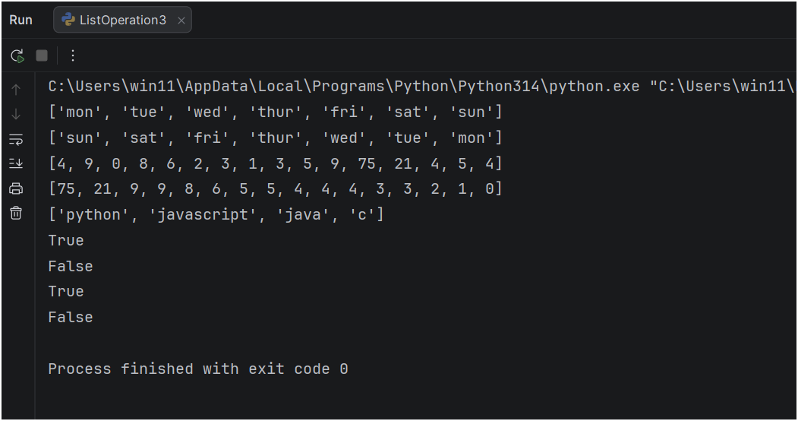

## Python Practice Question – Reversing, Sorting, and Membership in Lists

This folder contains a Python program that solves a **basic practice question** using list operations like reversing, sorting, and membership testing.

It is intended for beginners to strengthen their understanding of **core Python fundamentals** through simple problem-solving.

---

## 📌 Program Overview

The program in this folder covers the following practice concepts:

- Reversing the order of elements in a list.
- Sorting a list of numbers in ascending and descending order.
- Using membership operators (`in`, `not in`) to check if an item exists within a list.

The program executes predefined list operations and displays the results clearly in the console.

---

## 🧪 Code Functionality

The program demonstrates:

### List Methods
- **`reverse()`**: Reverses the elements of the list in place.
- **`sort()`**: Sorts the list in ascending order by default.
- **`sort(reverse=True)`**: Sorts the list in descending order.

### Membership Operators
- **`in`**: Returns `True` if the specified element is found in the list, otherwise `False`.
- **`not in`**: Returns `True` if the specified element is not found in the list, otherwise `False`.

The program is written in a **simple and readable format**.

---

## 🖥️ Output

The program prints the evaluated list operations directly to the console during execution.  
The complete console output for this practice question is shown below.

---

## 📂 File Information

- `ListOperation3.py` — Contains the practice question program  
- `Output.png` — Screenshot of console output  
- `README.md` — Folder documentation  

---
## 👨‍💻 Author

**MD Shahnawaz Noor**     
*Aspiring Data Scientist* 
   
GitHub: [https://github.com/shahnawaznoor2020-code](https://github.com/shahnawaznoor2020-code)             
Email: shahnawaznoor2020@gmaIl.com  
 
---

## ⭐ Note

These practice programs help build a strong foundation in Python.  
They are essential before moving to conditions, loops, and advanced logic.
