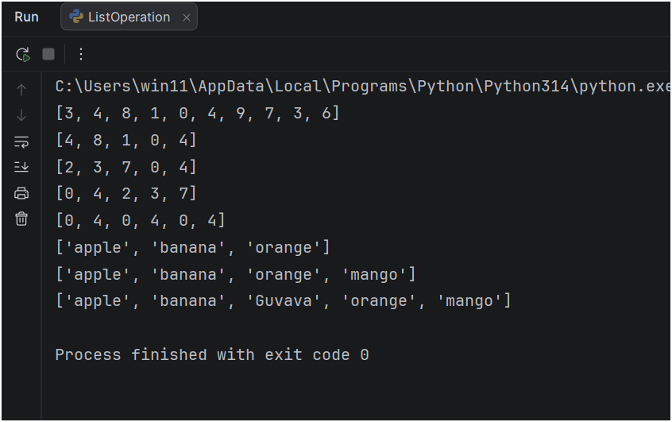

## Python Practice Question – List Operations

This folder contains a Python program that solves a **basic practice question** using list slicing, concatenation, repetition, and built-in list methods.

It is intended for beginners to strengthen their understanding of **core Python fundamentals** through simple problem-solving.

---

## 📌 Program Overview

The program in this folder covers the following practice concepts:

- Slicing a list to extract a specific sublist.
- Concatenating and repeating lists using standard operators.
- Adding elements to a list using the `append()` and `insert()` methods.

The program executes predefined list operations and displays the results clearly in the console.

---

## 🧪 Code Functionality

The program demonstrates:

### List Manipulation Operators
- **Slicing (`[start:stop:step]`)**: Extracts a portion of the list.
- **Concatenation (`+`)**: Joins two distinct lists together to form a new list.
- **Repetition (`*`)**: Repeats the elements of a list a specified number of times.

### Built-in List Methods
- **`append(element)`**: Adds a single element to the very end of the list.
- **`insert(index, element)`**: Inserts a new element at a specific index, shifting existing elements to the right.

The program is written in a **simple and readable format**.

---

## 🖥️ Output

The program prints the evaluated list operations directly to the console during execution.  
The complete console output for this practice question is shown below.

---

## 📂 File Information

- `ListOperation.py` — Contains the practice question program  
- `Output.png` — Screenshot of console output  
- `README.md` — Folder documentation  

---
## 👨‍💻 Author

**MD Shahnawaz Noor**     
*Aspiring Data Scientist* 
   
GitHub: [https://github.com/shahnawaznoor2020-code](https://github.com/shahnawaznoor2020-code)             
Email: shahnawaznoor2020@gmaIl.com  
 
---

## ⭐ Note

These practice programs help build a strong foundation in Python.  
They are essential before moving to conditions, loops, and advanced logic.
