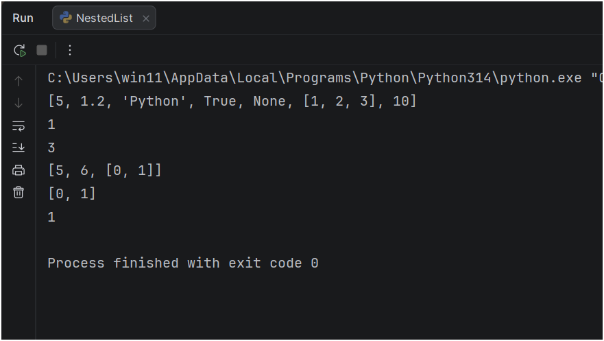

## Python Practice Question – Nested Lists

This folder contains a Python program that solves a **basic practice question** using list nesting, multi-dimensional indexing, and the `len()` function.

It is intended for beginners to strengthen their understanding of **core Python fundamentals** through simple problem-solving.

---

## 📌 Program Overview

The program in this folder covers the following practice concepts:

- Creating lists that contain other lists (nested lists).
- Navigating nested lists using multiple index brackets.
- Understanding how the `len()` function evaluates nested list elements.

The program executes predefined nested list operations and displays the results clearly in the console.

---

## 🧪 Code Functionality

The program demonstrates:

### Nested List Access
- **Single-level Indexing**: Accessing standard elements within a list.
- **Multi-level Indexing (`l2[-1][-1]`)**: Chaining index brackets to drill down into lists that reside within other lists.

### List Properties
- **`len()` behavior**: Counting the top-level elements of a nested list, treating sublists as single elements regardless of their internal size.

The program is written in a **simple and readable format**.

---

## 🖥️ Output

The program prints the evaluated nested list operations directly to the console during execution.  
The complete console output for this practice question is shown below.

---

## 📂 File Information

- `NestedList.py` — Contains the practice question program  
- `Output.png` — Screenshot of console output  
- `README.md` — Folder documentation  

---
## 👨‍💻 Author

**MD Shahnawaz Noor**     
*Aspiring Data Scientist* 
   
GitHub: [https://github.com/shahnawaznoor2020-code](https://github.com/shahnawaznoor2020-code)             
Email: shahnawaznoor2020@gmaIl.com  
 
---

## ⭐ Note

These practice programs help build a strong foundation in Python.  
They are essential before moving to conditions, loops, and advanced logic.
