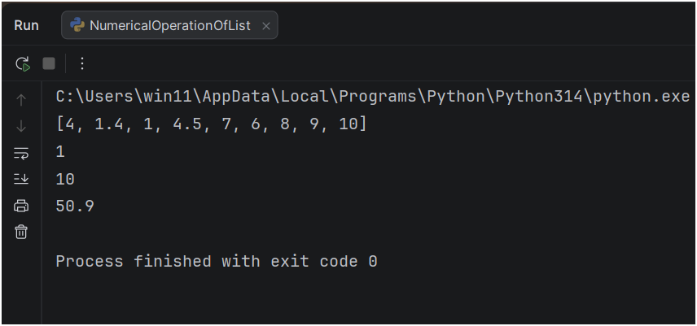

## Python Practice Question – Numerical Operations on a List

This folder contains a Python program that solves a **basic practice question** using built-in numerical functions applied to a list of numbers.

It is intended for beginners to strengthen their understanding of **core Python fundamentals** through simple problem-solving.

---

## 📌 Program Overview

The program in this folder covers the following practice concepts:

- Finding the smallest and largest values in a list of mixed numbers (integers and floats).
- Calculating the total sum of all numerical elements within the list.

The program executes predefined numerical list operations and displays the results clearly in the console.

---

## 🧪 Code Functionality

The program demonstrates:

### Built-in List Functions
- **`min()`**: Scans the iterable (list) and returns the minimum (smallest) value.
- **`max()`**: Scans the iterable (list) and returns the maximum (largest) value.
- **`sum()`**: Iterates through the list and calculates the total sum of all numeric values.

### Handling Mixed Data
- The list `numbers` contains both integer and floating-point values (e.g., `4, 1.4, 4.5`), demonstrating that Python's numerical functions can seamlessly process mixed numeric types.

The program is written in a **simple and readable format**.

---

## 🖥️ Output

The program prints the evaluated list properties directly to the console during execution.  
The complete console output for this practice question is shown below.

---

## 📂 File Information

- `NumericalOperationOfList.py` — Contains the practice question program  
- `Output.png` — Screenshot of console output  
- `README.md` — Folder documentation  

---
## 👨‍💻 Author

**MD Shahnawaz Noor**     
*Aspiring Data Scientist* 
   
GitHub: [https://github.com/shahnawaznoor2020-code](https://github.com/shahnawaznoor2020-code)             
Email: shahnawaznoor2020@gmaIl.com  
 
---

## ⭐ Note

These practice programs help build a strong foundation in Python.  
They are essential before moving to conditions, loops, and advanced logic.
