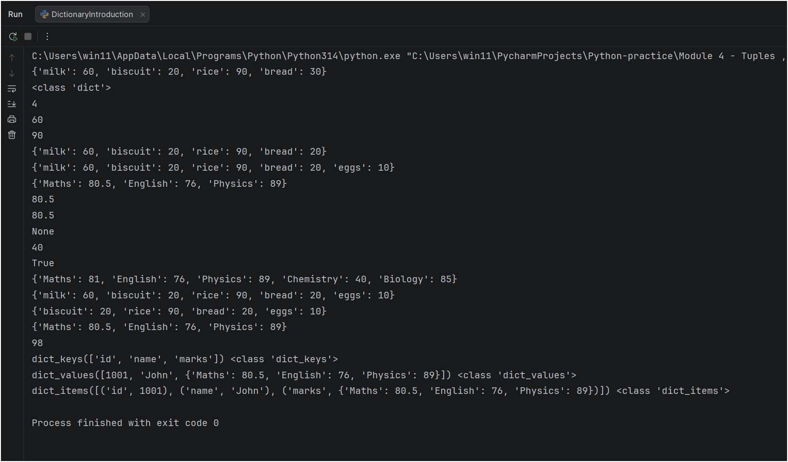

## Python Practice Question – Introduction to Dictionaries

This folder contains a Python program that solves a **basic practice question** using dictionary creation, modification, and built-in dictionary methods.

It is intended for beginners to strengthen their understanding of **core Python fundamentals** through simple problem-solving.

---

## 📌 Program Overview

The program in this folder covers the following practice concepts:

- Creating dictionaries with key-value pairs and understanding key immutability rules.
- Accessing, adding, and updating values using keys and the `get()` method.
- Merging dictionaries and removing specific elements.
- Retrieving keys, values, and key-value items from the dictionary.

The program executes predefined dictionary operations and displays the dynamically changing data in the console.

---

## 🧪 Code Functionality

The program demonstrates:

### Dictionary Fundamentals
- **Creation (`{key: value}`)**: Initializing dictionaries and accessing values via `dict[key]`.
- **`get(key, default)`**: Safely fetching a value without raising an error if the key doesn't exist, optionally returning a default value.
- **Immutability Rules**: Highlighting that keys must be immutable (e.g., strings, integers, tuples), while values can be any data type (including lists and other dictionaries).

### Dictionary Modification
- **Adding/Updating**: Assigning a value to a new or existing key (`dict[key] = value`).
- **`update()`**: Merging another dictionary's key-value pairs into the current dictionary.
- **`pop(key)`**: Removing a specified key and returning its associated value.

### Built-in Methods
- **`keys()`**: Returns a view object of all keys in the dictionary.
- **`values()`**: Returns a view object of all values in the dictionary.
- **`items()`**: Returns a view object of all key-value tuple pairs.

The program is written in a **simple and readable format**.

---

## 🖥️ Output

The program prints the evaluated dictionary operations directly to the console during execution.  
The complete console output for this practice question is shown below.

---

## 📂 File Information

- `DictionaryIntroduction.py` — Contains the practice question program  
- `Output.png` — Screenshot of console output  
- `README.md` — Folder documentation  

---
## 👨‍💻 Author

**MD Shahnawaz Noor**     
*Aspiring Data Scientist* 
   
GitHub: [https://github.com/shahnawaznoor2020-code](https://github.com/shahnawaznoor2020-code)             
Email: shahnawaznoor2020@gmaIl.com  
 
---

## ⭐ Note

These practice programs help build a strong foundation in Python.  
They are essential before moving to conditions, loops, and advanced logic.
