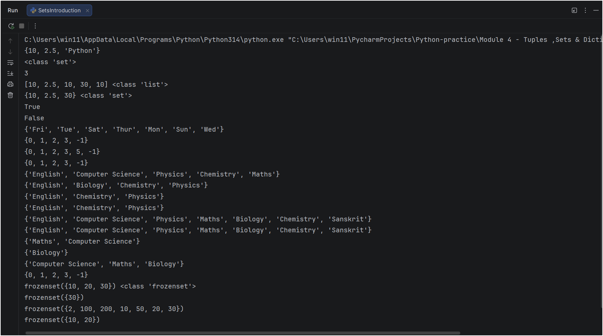

## Python Practice Question – Introduction to Sets

This folder contains a Python program that solves a **basic practice question** using set creation, modification, and mathematical set operations.

It is intended for beginners to strengthen their understanding of **core Python fundamentals** through simple problem-solving.

---

## 📌 Program Overview

The program in this folder covers the following practice concepts:

- Creating sets and understanding their non-sequential, duplicate-free nature.
- Modifying sets using `add()`, `remove()`, and `discard()`.
- Performing mathematical set operations: intersection, union, difference, and symmetric difference.
- Exploring immutable sets using `frozenset()`.

The program executes predefined set operations and displays the results clearly in the console.

---

## 🧪 Code Functionality

The program demonstrates:

### Set Fundamentals
- **Creation (`{...}`)**: Initializing sets with various data types.
- **Duplicate Removal**: Showing how sets automatically eliminate duplicate values (e.g., `l2={10,2.5,10,30,10}`).
- **Membership (`in`)**: Checking for the existence of an element within a set.

### Set Modification
- **`add()`**: Inserting a new element into the set.
- **`remove()`**: Deleting a specific element (raises an error if not found).
- **`discard()`**: Deleting a specific element (does nothing if not found).

### Mathematical Operations
- **Intersection (`&` or `intersection()`)**: Finding common elements between sets.
- **Union (`|` or `union()`)**: Combining all unique elements from multiple sets.
- **Difference (`-` or `difference()`)**: Finding elements present in one set but not the other.
- **Symmetric Difference (`symmetric_difference()`)**: Finding elements present in either set, but not in both.

### Frozensets
- **`frozenset()`**: Creating immutable sets that support mathematical operations but cannot be modified (no `add` or `remove`).

The program is written in a **simple and readable format**.

---

## 🖥️ Output

The program prints the evaluated set operations directly to the console during execution.  
The complete console output for this practice question is shown below.

---

## 📂 File Information

- `SetsIntroduction.py` — Contains the practice question program  
- `Output.png` — Screenshot of console output  
- `README.md` — Folder documentation  

---
## 👨‍💻 Author

**MD Shahnawaz Noor**     
*Aspiring Data Scientist* 
   
GitHub: [https://github.com/shahnawaznoor2020-code](https://github.com/shahnawaznoor2020-code)             
Email: shahnawaznoor2020@gmaIl.com  
 
---

## ⭐ Note

These practice programs help build a strong foundation in Python.  
They are essential before moving to conditions, loops, and advanced logic.
