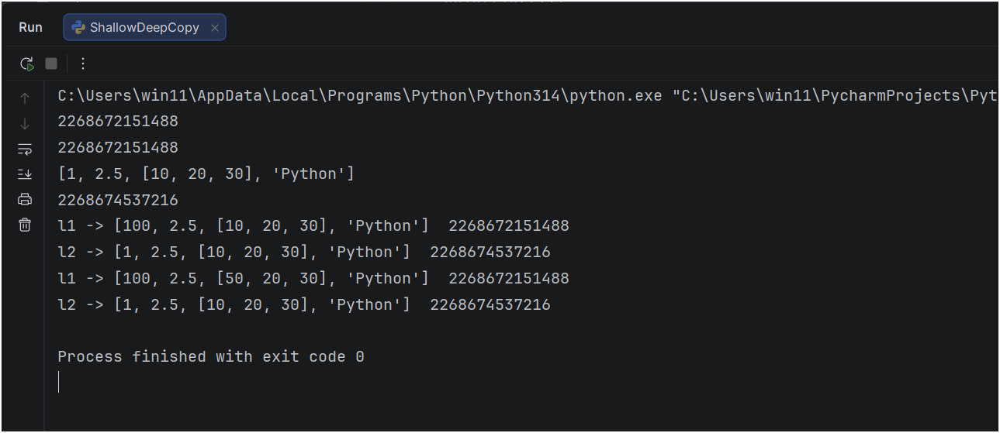

## Python Practice Question – Shallow and Deep Copy

This folder contains a Python program that solves a **basic practice question** using list assignment and the `copy` module.

It is intended for beginners to strengthen their understanding of **core Python fundamentals** through simple problem-solving.

---

## 📌 Program Overview

The program in this folder covers the following practice concepts:

- Understanding memory references using the `id()` function.
- Demonstrating the difference between standard variable assignment and copying.
- Implementing **deep copy** operations on nested lists.

The program executes predefined list modifications and displays the memory addresses to clearly illustrate how Python handles object copying.

---

## 🧪 Code Functionality

The program demonstrates:

### Copy Operations
- **Assignment (`=`)**: Creates a new reference to the exact same object in memory.
- **Deep Copy (`copy.deepcopy()`)**: Recursively copies all elements, creating a fully independent clone of the original nested list. Modifying the original list (even nested elements) does not affect the deep copy.
- **Shallow Copy (`copy.copy()`)**: Included in the source as a conceptual stepping stone to understanding partial vs. full independence in nested structures.

### Memory Management
- **`id()`**: Returns the unique memory address of an object, used here to prove whether two variables point to the same or different locations.
- **Nested Lists Modification**: Accessing and updating specific sublist elements (`l1[2][0] = 50`) to test copy independence.

The program is written in a **simple and readable format**.

---

## 🖥️ Output

The program prints the evaluated copy operations and memory addresses directly to the console during execution.  
The complete console output for this practice question is shown below.

---

## 📂 File Information

- `ShallowDeepCopy.py` — Contains the practice question program  
- `Output.png` — Screenshot of console output  
- `README.md` — Folder documentation  

---
## 👨‍💻 Author

**MD Shahnawaz Noor**     
*Aspiring Data Scientist* 
   
GitHub: [https://github.com/shahnawaznoor2020-code](https://github.com/shahnawaznoor2020-code)             
Email: shahnawaznoor2020@gmaIl.com  
 
---

## ⭐ Note

These practice programs help build a strong foundation in Python.  
They are essential before moving to conditions, loops, and advanced logic.
