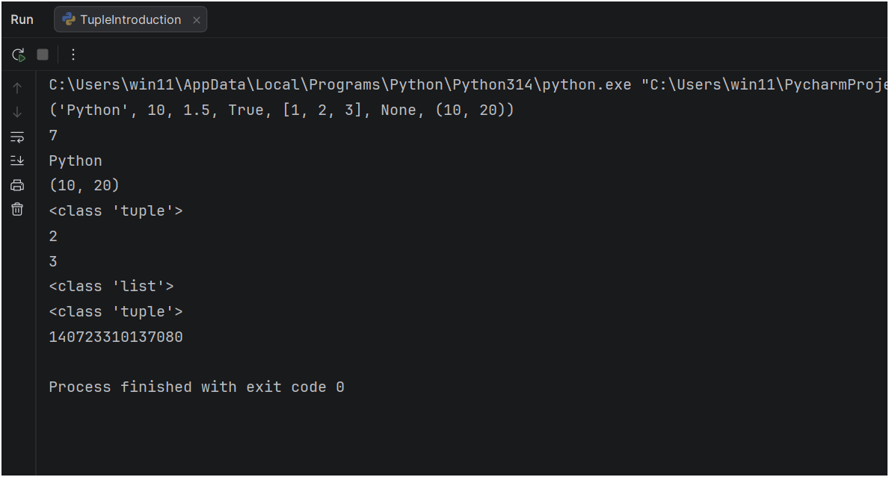

## Python Practice Question – Introduction to Tuples

This folder contains a Python program that solves a **basic practice question** using tuple creation, indexing, and basic tuple methods.

It is intended for beginners to strengthen their understanding of **core Python fundamentals** through simple problem-solving.

---

## 📌 Program Overview

The program in this folder covers the following practice concepts:

- Creating tuples with mixed data types (strings, integers, floats, booleans, lists, and nested tuples).
- Accessing tuple elements via indexing and finding the length of a tuple.
- Creating tuples without explicit parentheses (tuple packing).
- Exploring built-in tuple methods and converting a list into a tuple.

The program executes predefined tuple operations and displays the results clearly in the console.

---

## 🧪 Code Functionality

The program demonstrates:

### Tuple Creation and Access
- **Creation (`(...)`)**: Initializing a tuple with diverse data types.
- **Tuple Packing**: Demonstrating that parentheses are optional when assigning multiple comma-separated values to a variable (e.g., `t1 = 1, 2, 7...`).
- **Indexing**: Retrieving specific elements using positive (`t1[0]`) and negative (`t1[-1]`) indices.
- **Length (`len()`)**: Returning the total number of elements.

### Tuple Methods and Conversion
- **`index(value)`**: Finding the first index position of a specified value.
- **`count(value)`**: Counting how many times a specific value appears in the tuple.
- **`tuple(iterable)`**: Type-casting a list (`l1`) into an immutable tuple (`t2`).
- **`id()` function**: Retrieving the unique memory address of an object (demonstrated with a variable).

The program is written in a **simple and readable format**.

---

## 🖥️ Output

The program prints the evaluated tuple properties directly to the console during execution.  
The complete console output for this practice question is shown below.

---

## 📂 File Information

- `TupleIntroduction.py` — Contains the practice question program  
- `Output.png` — Screenshot of console output  
- `README.md` — Folder documentation  

---
## 👨‍💻 Author

**MD Shahnawaz Noor**     
*Aspiring Data Scientist* 
   
GitHub: [https://github.com/shahnawaznoor2020-code](https://github.com/shahnawaznoor2020-code)             
Email: shahnawaznoor2020@gmaIl.com  
 
---

## ⭐ Note

These practice programs help build a strong foundation in Python.  
They are essential before moving to conditions, loops, and advanced logic.
