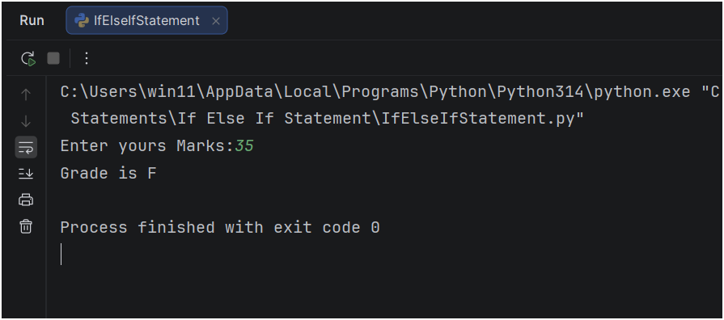
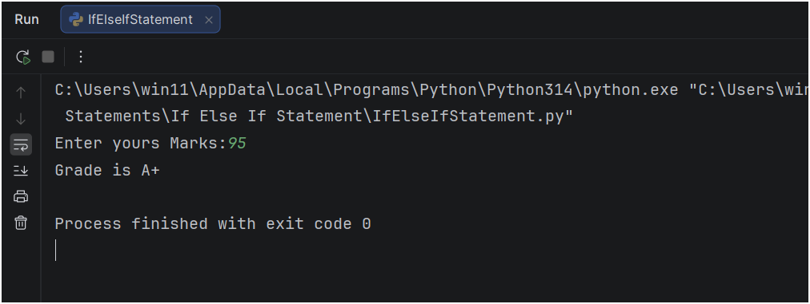
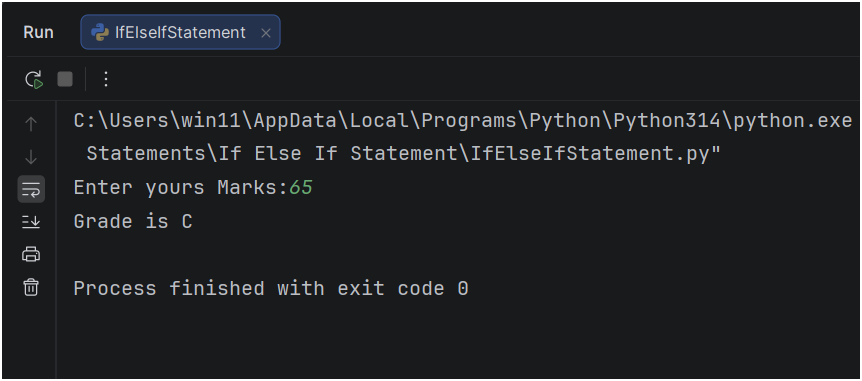

## Python Practice Question – If-Elif-Else Statements

This folder contains a Python program that solves a **basic practice question** using the `if-elif-else` conditional ladder.

It is intended for beginners to strengthen their understanding of **core Python fundamentals** through simple problem-solving.

---

## 📌 Program Overview

The program in this folder covers the following practice concepts:

- Evaluating multiple conditions sequentially using an `if-elif-else` ladder.
- Using chained comparison operators (e.g., `90 <= marks <= 100`) to check if a value falls within a specific range.
- Building a simple grading system based on numerical input.

The program executes predefined conditional checks based on user input and displays the calculated grade clearly in the console.

---

## 🧪 Code Functionality

The program demonstrates:

### Conditional Statements
- **`if` block**: Evaluates the initial condition (marks between 90 and 100).
- **`elif` blocks**: (Else If) Evaluates subsequent conditions one by one if the preceding conditions evaluate to `False`.
- **`else` block**: Acts as a catch-all for any input that does not meet any of the specified `if` or `elif` conditions (in this case, marks below 40).

### Operators
- **Chained Comparison Operators**: Python allows chaining like `lower_bound <= value <= upper_bound` for clean and readable range checking.

The program is written in a **simple and readable format**.

---

## 🖥️ Output

The program evaluates the marks and prints the corresponding grade directly to the console during execution.  
The complete console output for this practice question is shown below.

---

## 📂 File Information

- `IfElseIfStatement.py` — Contains the practice question program  
- `Output_1.png` — Screenshot of console output (Part 1)  
- `Output_2.png` — Screenshot of console output (Part 2)  
- `Output_3.png` — Screenshot of console output (Part 3)  
- `README.md` — Folder documentation  

---
## 👨‍💻 Author

**MD Shahnawaz Noor**     
*Aspiring Data Scientist* 
   
GitHub: [https://github.com/shahnawaznoor2020-code](https://github.com/shahnawaznoor2020-code)             
Email: shahnawaznoor2020@gmaIl.com  
 
---

## ⭐ Note

These practice programs help build a strong foundation in Python.  
They are essential before moving to loops and advanced logic.
