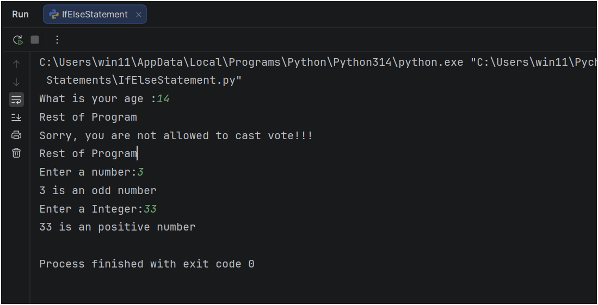
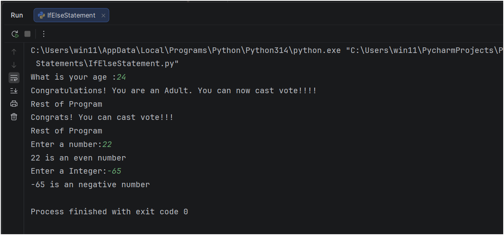

## Python Practice Question – If-Else Statements

This folder contains a Python program that solves a **basic practice question** using conditional statements (`if` and `if-else`).

It is intended for beginners to strengthen their understanding of **core Python fundamentals** through simple problem-solving.

---

## 📌 Program Overview

The program in this folder covers the following practice concepts:

- Using `if` statements to check a single condition (e.g., voting eligibility).
- Implementing `if-else` blocks to handle binary outcomes.
- Determining if a number is odd or even using the modulo operator.
- Checking whether an integer is positive or negative.

The program executes predefined conditional checks based on user input and displays the results clearly in the console.

---

## 🧪 Code Functionality

The program demonstrates:

### Conditional Statements
- **`if` block**: Executes a specific block of code only if the provided condition evaluates to `True`.
- **`if-else` block**: Provides an alternative block of code to execute when the `if` condition evaluates to `False`.

### Operators
- **Modulo (`%`)**: Used to determine the remainder of a division (checking for even/odd numbers).
- **Comparison Operators (`>=`, `==`)**: Used to compare values and control the flow of the program.

The program is written in a **simple and readable format**.

---

## 🖥️ Output

The program evaluates the conditions and prints the formatted text directly to the console during execution.  
The complete console output for this practice question is shown below.

---

## 📂 File Information

- `IfElseStatement.py` — Contains the practice question program  
- `Output_1.png` — Screenshot of console output (Part 1)  
- `Output_2.png` — Screenshot of console output (Part 2)  
- `README.md` — Folder documentation  

---
## 👨‍💻 Author

**MD Shahnawaz Noor**     
*Aspiring Data Scientist* 
   
GitHub: [https://github.com/shahnawaznoor2020-code](https://github.com/shahnawaznoor2020-code)             
Email: shahnawaznoor2020@gmaIl.com  
 
---

## ⭐ Note

These practice programs help build a strong foundation in Python.  
They are essential before moving to loops and advanced logic.
