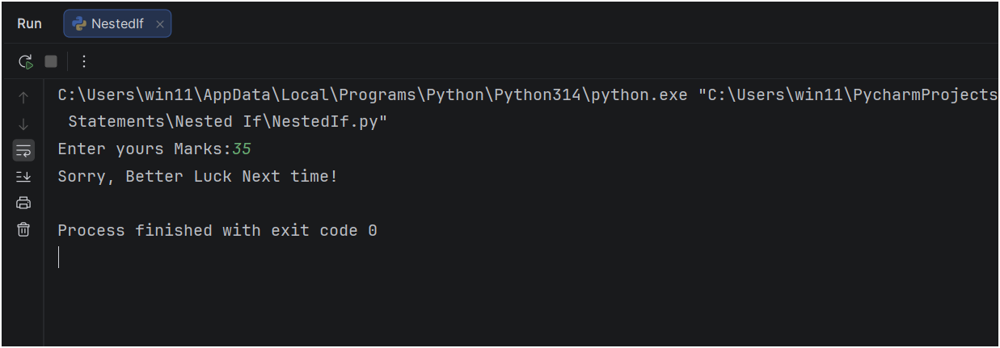
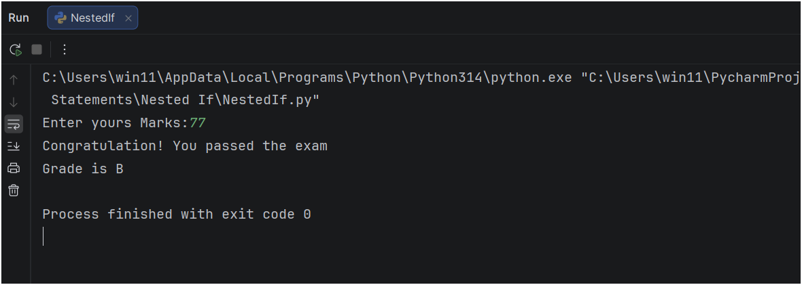

## Python Practice Question – Nested If Statements

This folder contains a Python program that solves a **basic practice question** using nested conditional statements.

It is intended for beginners to strengthen their understanding of **core Python fundamentals** through simple problem-solving.

---

## 📌 Program Overview

The program in this folder covers the following practice concepts:

- Using a primary `if` statement to check a broad condition (e.g., passing the exam).
- Nesting an `if-elif-else` block inside the primary `if` statement to evaluate more specific conditions (e.g., determining the exact grade based on marks).
- Handling the alternative to the broad condition using an outer `else` block.

The program executes predefined conditional checks based on user input and displays the results clearly in the console.

---

## 🧪 Code Functionality

The program demonstrates:

### Nested Conditional Logic
- **Outer `if` block**: Evaluates the main condition (`marks >= 40`). If `True`, the program enters the nested block.
- **Nested `if-elif-else` block**: Evaluates specific ranges of marks to assign a grade. This block only executes if the outer condition is met.
- **Outer `else` block**: Executes if the main condition is `False` (i.e., `marks < 40`), providing a separate path for failing marks.

The program is written in a **simple and readable format**, emphasizing proper indentation which is crucial for nested statements in Python.

---

## 🖥️ Output

The program evaluates the marks and prints the corresponding messages directly to the console during execution.  
The complete console output for this practice question is shown below.

---

## 📂 File Information

- `NestedIf.py` — Contains the practice question program  
- `Output_1.png` — Screenshot of console output (Part 1)  
- `Output_2.png` — Screenshot of console output (Part 2)  
- `README.md` — Folder documentation  

---
## 👨‍💻 Author

**MD Shahnawaz Noor**     
*Aspiring Data Scientist* 
   
GitHub: [https://github.com/shahnawaznoor2020-code](https://github.com/shahnawaznoor2020-code)             
Email: shahnawaznoor2020@gmaIl.com  
 
---

## ⭐ Note

These practice programs help build a strong foundation in Python.  
They are essential before moving to loops and advanced logic.
