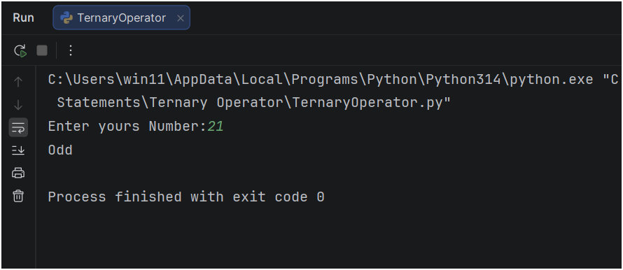
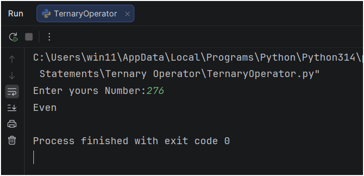

## Python Practice Question – Ternary Operator

This folder contains a Python program that solves a **basic practice question** using the ternary operator (conditional expression).

It is intended for beginners to strengthen their understanding of **core Python fundamentals** through simple problem-solving.

---

## 📌 Program Overview

The program in this folder covers the following practice concepts:

- Using the ternary operator for concise conditional logic.
- Condensing a standard `if-else` block into a single line of code.
- Determining if a number is odd or even using a streamlined expression.

The program executes predefined conditional checks based on user input and displays the results clearly in the console.

---

## 🧪 Code Functionality

The program demonstrates:

### Ternary Operator Syntax
- **`True_expression if condition else False_expression`**: This one-line conditional structure evaluates the condition first. If it is `True`, the first expression runs; if `False`, the expression after `else` runs.

### Implementation
- The script applies this syntax to an even/odd check: `print("Even") if num % 2 == 0 else print("Odd")`, replacing a traditional 4-line `if-else` block with a single, readable line.

The program is written in a **simple and readable format**.

---

## 🖥️ Output

The program evaluates the condition and prints the corresponding message directly to the console during execution.  
The complete console output for this practice question is shown below.

---

## 📂 File Information

- `TernaryOperator.py` — Contains the practice question program  
- `Output_1.png` — Screenshot of console output (Part 1)  
- `Output_2.png` — Screenshot of console output (Part 2)  
- `README.md` — Folder documentation  

---
## 👨‍💻 Author

**MD Shahnawaz Noor**     
*Aspiring Data Scientist* 
   
GitHub: [https://github.com/shahnawaznoor2020-code](https://github.com/shahnawaznoor2020-code)             
Email: shahnawaznoor2020@gmaIl.com  
 
---

## ⭐ Note

These practice programs help build a strong foundation in Python.  
They are essential before moving to conditions, loops, and advanced logic.
