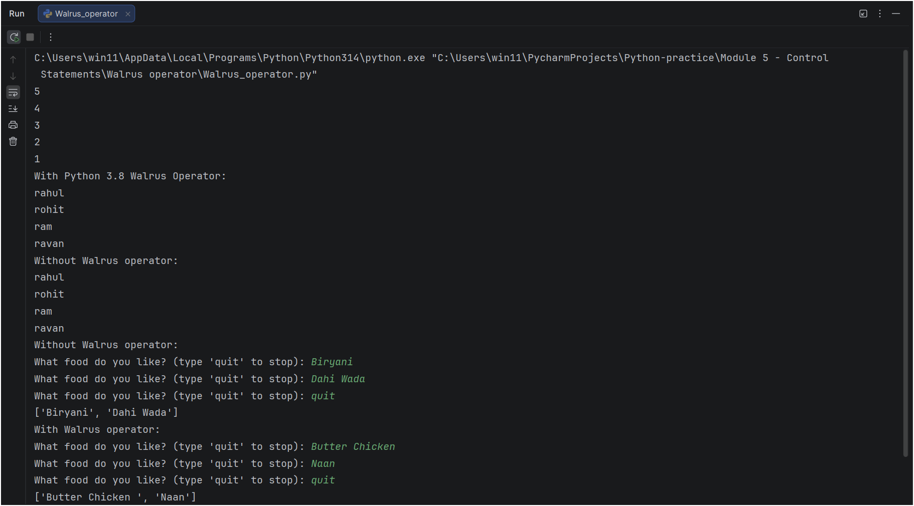

## Python Practice Question – Walrus Operator

This folder contains a Python program that solves a **basic practice question** demonstrating the use of the walrus operator (`:=`).

It is intended for beginners to strengthen their understanding of **core Python fundamentals** through simple problem-solving.

---

## 📌 Program Overview

The program in this folder covers the following practice concepts:

- Assigning values to variables as part of a larger expression using the walrus operator.
- Using the walrus operator within `while` loops for more concise code.
- Using the walrus operator within `if` conditions during iterations.
- Comparing code written with and without the walrus operator to highlight its efficiency.

The program executes predefined loops and conditional checks, displaying the results clearly in the console.

---

## 🧪 Code Functionality

The program demonstrates:

### Walrus Operator (`:=`)
- **Assignment Expression**: Allows you to assign a value to a variable and return that value in the same expression.
- **`while` Loop Integration**: Used to evaluate a condition (like length of a list or user input) and assign it simultaneously, reducing boilerplate code (e.g., `while (n := len(num)) > 0:`).
- **`if` Statement Integration**: Used to fetch a value from a dictionary and immediately evaluate its truthiness within the condition (e.g., `if name := entry.get("name"):`).

The program is written in a **simple and readable format**, explicitly contrasting approaches with and without the operator.

---

## 🖥️ Output

The program evaluates the assignment expressions and prints the corresponding output directly to the console during execution.  
The complete console output for this practice question is shown below.

---

## 📂 File Information

- `Walrus_operator.py` — Contains the practice question program  
- `Output.png` — Screenshot of console output  
- `README.md` — Folder documentation  

---
## 👨‍💻 Author

**MD Shahnawaz Noor**     
*Aspiring Data Scientist* 
   
GitHub: [https://github.com/shahnawaznoor2020-code](https://github.com/shahnawaznoor2020-code)             
Email: shahnawaznoor2020@gmaIl.com  
 
---

## ⭐ Note

These practice programs help build a strong foundation in Python.  
They are essential before moving to advanced logic and data structures.
