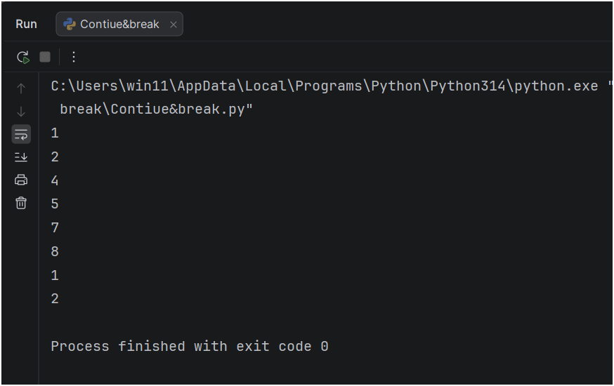

## Python Practice Question – Continue & Break Statements
 
This folder contains a Python program that solves a **basic practice question** demonstrating the use of `continue` and `break` statements within loops.

It is intended for beginners to strengthen their understanding of **core Python fundamentals** through simple problem-solving.

---

## 📌 Program Overview

The program in this folder covers the following practice concepts:

- Utilizing the `continue` statement to skip specific iterations within a loop.
- Using the `break` statement to prematurely exit a loop based on a condition.
- Iterating over sequences of numbers using the `range()` function.

The program executes predefined loops and conditional checks, displaying the altered iteration results clearly in the console.

---

## 🧪 Code Functionality

The program demonstrates:

### Loop Control Statements
- **`continue`**: When executed, it immediately stops the current iteration of the loop and jumps back to the top to begin the next iteration. In this program, it skips printing numbers that are divisible by 3.
- **`break`**: When executed, it immediately terminates the innermost loop entirely, regardless of whether all iterations are complete. In this program, the loop stops completely as soon as a number divisible by 3 is encountered.

### `range()` Function
- **`range(stop)`**: Generates a sequence of numbers from 0 up to, but not including, the `stop` value (e.g., `range(10)` generates 0 through 9).
- **`range(start, stop)`**: Generates a sequence of numbers starting from `start` up to, but not including, the `stop` value.

The program is written in a **simple and readable format**.

---

## 🖥️ Output

The program evaluates the loop conditions and prints the resulting numbers directly to the console during execution.  
The complete console output for this practice question is shown below.

---

## 📂 File Information

- `Contiue&break.py` — Contains the practice question program  
- `Output.png` — Screenshot of console output  
- `README.md` — Folder documentation  

---
## 👨‍💻 Author

**MD Shahnawaz Noor**     
*Aspiring Data Scientist* 
   
GitHub: [https://github.com/shahnawaznoor2020-code](https://github.com/shahnawaznoor2020-code)             
Email: shahnawaznoor2020@gmaIl.com  
 
---

## ⭐ Note

These practice programs help build a strong foundation in Python.  
They are essential before moving to functions and advanced logic.
