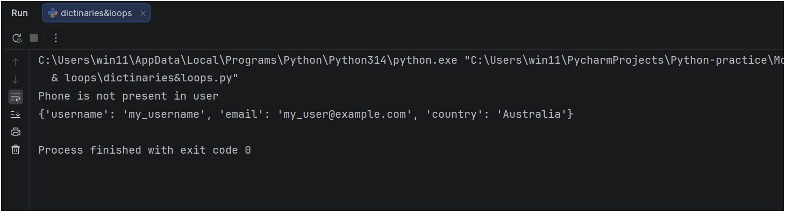

## Python Practice Question – Dictionaries and Loops

This folder contains a Python program that solves a **basic practice question** by combining loops, conditional statements, and dictionary methods to filter sensitive data.

It is intended for beginners to strengthen their understanding of **core Python fundamentals** through simple problem-solving.

---

## 📌 Program Overview

The program in this folder covers the following practice concepts:

- Storing structured data in a dictionary and a list of target keys to remove.
- Iterating through a list using a `for` loop.
- Using the membership operator (`in`) to check if a key exists in a dictionary safely.
- Removing specific key-value pairs from a dictionary using the `pop()` method.

The program executes the data filtration loop and displays the updated dictionary and missing keys clearly in the console.

---

## 🧪 Code Functionality

The program demonstrates:

### Loops & Conditionals
- **`for` loop**: Iterates directly over the `sensetive_info` list, checking each item one by one.
- **`if i in user:`**: A safe way to check if a key exists within a dictionary before attempting to remove or access it, preventing `KeyError` exceptions.

### Dictionary Methods
- **`pop(key)`**: Removes the specified key from the dictionary and returns its value. In this script, it is used to delete sensitive user information like "password" and "address".

The program is written in a **simple and readable format**.

---

## 🖥️ Output

The program evaluates the keys and prints the corresponding removal messages and the final dictionary directly to the console during execution.  
The complete console output for this practice question is shown below.

---

## 📂 File Information

- `dictinaries&loops.py` — Contains the practice question program  
- `Output.png` — Screenshot of console output  
- `README.md` — Folder documentation  

---
## 👨‍💻 Author

**MD Shahnawaz Noor**     
*Aspiring Data Scientist* 
   
GitHub: [https://github.com/shahnawaznoor2020-code](https://github.com/shahnawaznoor2020-code)             
Email: shahnawaznoor2020@gmaIl.com  
 
---

## ⭐ Note

These practice programs help build a strong foundation in Python.  
They are essential before moving to functions and advanced logic.
