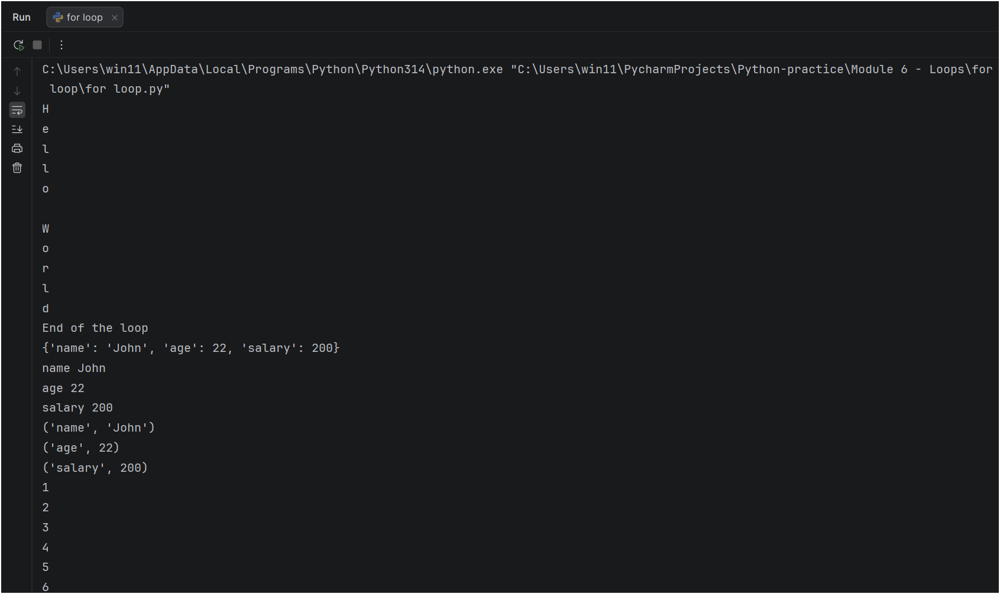
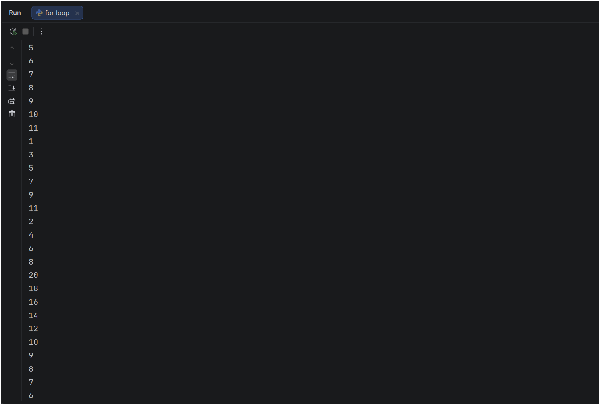
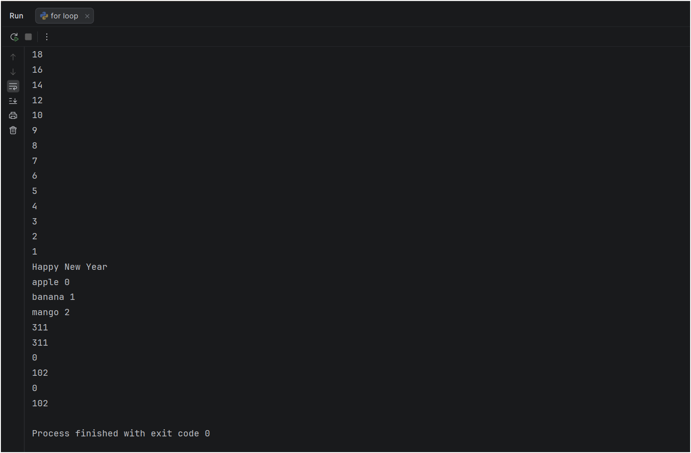

## Python Practice Question – For Loops and the Range Function

This folder contains a Python program that solves a **basic practice question** demonstrating the use of `for` loops across various data structures and the `range()` function.

It is intended for beginners to strengthen their understanding of **core Python fundamentals** through simple problem-solving.

---

## 📌 Program Overview

The program in this folder covers the following practice concepts:

- Iterating through strings, lists, and dictionaries using `for` loops.
- Using the `range()` function to generate numerical sequences with specific start, stop, and step values (including reverse iteration).
- Accessing list elements by their index using `range(len())`.
- Finding the maximum, minimum, and total sum of a list both manually via a loop and using Python's built-in functions (`max()`, `min()`, `sum()`).

The program executes predefined iterations and conditional checks, displaying the results clearly in the console.

---

## 🧪 Code Functionality

The program demonstrates:

### Iteration Mechanisms
- **String & List Iteration**: Directly looping through each character of a string or item in a list.
- **Dictionary Iteration**: Looping through dictionary keys and using `.items()` to access both keys and values.

### The `range()` Function
- **Syntax (`start`, `stop`, `step`)**: Generates a sequence of integers. 
- **Reverse Iteration**: Using a negative step value (e.g., `range(20, 10, -2)`) to count backward.

### Manual vs Built-in Logic
- Compares manual loop-based logic for aggregating data (summing totals, finding highest/lowest values) against Python's optimized built-in functions.

The program is written in a **simple and readable format**.

---

## 🖥️ Output

The program evaluates the loops and prints the corresponding output directly to the console during execution.  
The complete console output for this practice question is shown below.

---

## 📂 File Information

- `for loop.py` — Contains the practice question program  
- `Output_1.png` — Screenshot of console output (Part 1)  
- `Output_2.png` — Screenshot of console output (Part 2)  
- `Output_3.png` — Screenshot of console output (Part 3)  
- `README.md` — Folder documentation  

---
## 👨‍💻 Author

**MD Shahnawaz Noor**     
*Aspiring Data Scientist* 
   
GitHub: [https://github.com/shahnawaznoor2020-code](https://github.com/shahnawaznoor2020-code)             
Email: shahnawaznoor2020@gmaIl.com  
 
---

## ⭐ Note

These practice programs help build a strong foundation in Python.  
They are essential before moving to functions and advanced logic.
