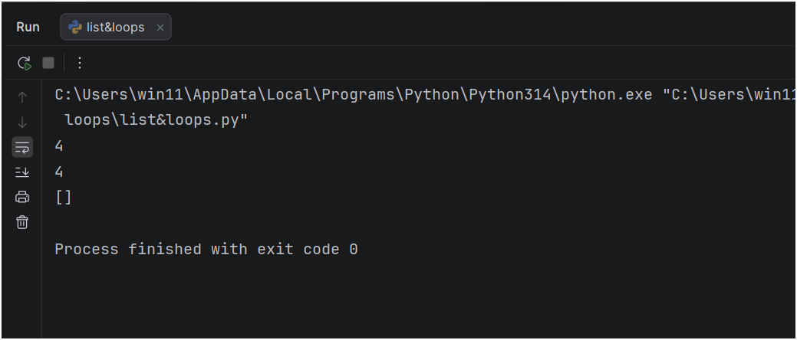

## Python Practice Question – Lists and Loops

This folder contains a Python program that solves a **basic practice question** by iterating through a list of strings and filtering elements based on specific character conditions.

It is intended for beginners to strengthen their understanding of **core Python fundamentals** through simple problem-solving.

---

## 📌 Program Overview

The program in this folder covers the following practice concepts:

- Iterating through a list of string elements using a `for` loop.
- Checking the starting character of a string using both index positioning and built-in string methods.
- Maintaining a counter to track the number of matching elements.
- Creating a new list by appending elements that satisfy a specific condition.

The program executes the loops and conditional checks, displaying the count and the filtered list clearly in the console.

---

## 🧪 Code Functionality

The program demonstrates:

### String Checking Techniques
- **String Indexing (`string[0]`)**: Retrieves the first character of the string to manually check if it matches a specific letter (e.g., `'I'`).
- **`startswith(substring)`**: A built-in string method used to check if the string begins with a specified substring (e.g., `'i'`). Note that string comparisons in Python are case-sensitive.

### List Modification and Counting
- **Counter Variable**: Using a standard integer variable (`count`) that increments (`count = count + 1`) every time a condition is met.
- **`append(element)`**: Adds a passing element to the end of a newly initialized empty list (`output`), effectively filtering the original dataset.

The program is written in a **simple and readable format**.

---

## 🖥️ Output

The program evaluates the list conditions and prints the final counts and filtered output list directly to the console during execution.  
The complete console output for this practice question is shown below.

---

## 📂 File Information

- `list&loops.py` — Contains the practice question program  
- `Output.png` — Screenshot of console output  
- `README.md` — Folder documentation  

---
## 👨‍💻 Author

**MD Shahnawaz Noor**     
*Aspiring Data Scientist* 
   
GitHub: [https://github.com/shahnawaznoor2020-code](https://github.com/shahnawaznoor2020-code)             
Email: shahnawaznoor2020@gmaIl.com  
 
---

## ⭐ Note

These practice programs help build a strong foundation in Python.  
They are essential before moving to functions and advanced logic.
