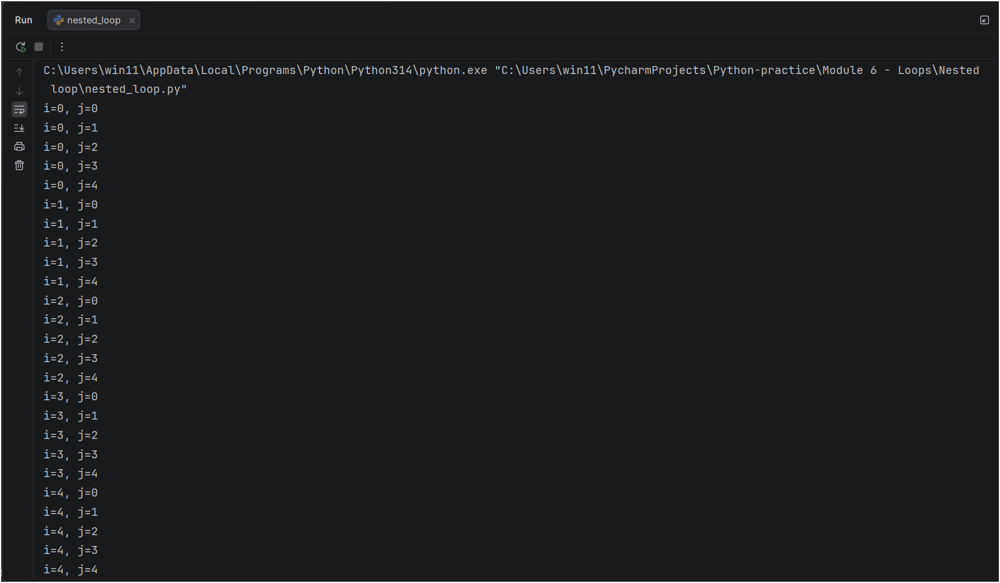

## Python Practice Question – Nested Loops

This folder contains a Python program that solves a **basic practice question** demonstrating the concept and execution of nested `for` loops.

It is intended for beginners to strengthen their understanding of **core Python fundamentals** through simple problem-solving.

---

## 📌 Program Overview

The program in this folder covers the following practice concepts:

- Implementing a `for` loop inside another `for` loop.
- Understanding the execution flow: how the inner loop completes all its iterations for every single iteration of the outer loop.
- Using formatted strings (f-strings) to dynamically print variable values.

The program executes the nested loops and displays the changing values of both loop counters clearly in the console.

---

## 🧪 Code Functionality

The program demonstrates:

### Nested Loops Execution
- **Outer Loop (`for i in range(5):`)**: The primary loop that runs 5 times (where `i` goes from 0 to 4).
- **Inner Loop (`for j in range(5):`)**: The secondary loop nested inside the outer loop. For *each* value of `i`, this inner loop runs completely from start to finish (where `j` goes from 0 to 4).
- **Total Iterations**: Because the inner loop runs 5 times for each of the 5 times the outer loop runs, the print statement executes a total of 25 times (5 * 5).

### String Formatting
- **f-strings (`f"..."`)**: Used to embed the current values of the variables `i` and `j` directly into the printed output string.

The program is written in a **simple and readable format**.

---

## 🖥️ Output

The program evaluates the loop ranges and prints the combined iteration values directly to the console during execution.  
The complete console output for this practice question is shown below.

---

## 📂 File Information

- `nested_loop.py` — Contains the practice question program  
- `Output.png` — Screenshot of console output  
- `README.md` — Folder documentation  

---
## 👨‍💻 Author

**MD Shahnawaz Noor**     
*Aspiring Data Scientist* 
   
GitHub: [https://github.com/shahnawaznoor2020-code](https://github.com/shahnawaznoor2020-code)             
Email: shahnawaznoor2020@gmaIl.com  
 
---

## ⭐ Note

These practice programs help build a strong foundation in Python.  
They are essential before moving to functions and advanced logic.
