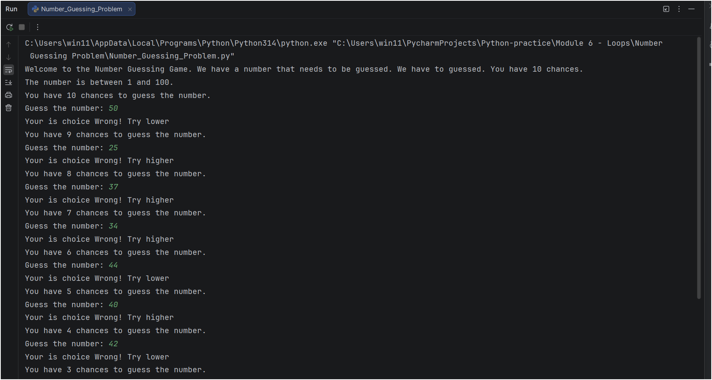

## Python Practice Question – Number Guessing Game

This folder contains a Python program that solves a **basic practice question** demonstrating the use of `while` loops, conditional statements, and the `random` module to create an interactive number guessing game.

It is intended for beginners to strengthen their understanding of **core Python fundamentals** through simple problem-solving.

---

## 📌 Program Overview

The program in this folder covers the following practice concepts:

- Utilizing the `random` module to generate a random number within a specific range.
- Using a `while` loop to manage a limited number of user attempts (10 chances).
- Employing `if-elif-else` statements to provide feedback on whether the guess is too high, too low, or correct.
- Terminating the game loop early using the `break` statement when the correct number is guessed.

The program executes an interactive game, prompting the user for input and displaying dynamic feedback in the console.

---

## 🧪 Code Functionality

The program demonstrates:

### Key Components
- **`random.randint(start, end)`**: Generates a random integer between `start` and `end` (inclusive).
- **`while count > 0:`**: A control flow structure that repeats the guessing logic as long as the user has chances remaining.
- **`break`**: Immediately exits the `while` loop if the user correctly guesses the number before running out of attempts.
- **`count = count - 1`**: Decrements the user's available attempts after each incorrect guess.

The program is written in a **simple and readable format**.

---

## 🖥️ Output

The program provides interactive feedback directly to the console during execution.  
The complete console output for this practice question is shown below.

---

## 📂 File Information

- `Number_Guessing_Problem.py` — Contains the practice question program  
- `Output.png` — Screenshot of console output  
- `README.md` — Folder documentation  

---
## 👨‍💻 Author

**MD Shahnawaz Noor**     
*Aspiring Data Scientist* 
   
GitHub: [https://github.com/shahnawaznoor2020-code](https://github.com/shahnawaznoor2020-code)             
Email: shahnawaznoor2020@gmaIl.com  
 
---

## ⭐ Note

These practice programs help build a strong foundation in Python.  
They are essential before moving to functions and advanced logic.
