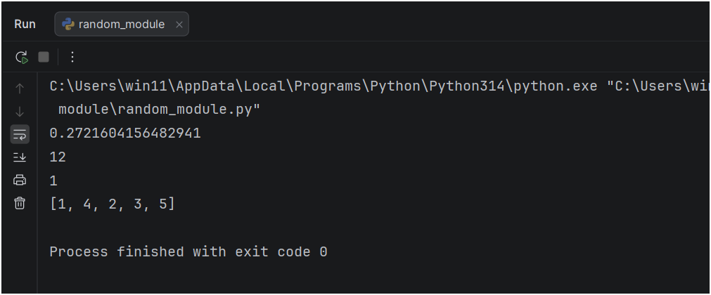

## Python Practice Question – The Random Module

This folder contains a Python program that solves a **basic practice question** demonstrating various functions available in the built-in `random` module.

It is intended for beginners to strengthen their understanding of **core Python fundamentals** through simple problem-solving.

---

## 📌 Program Overview

The program in this folder covers the following practice concepts:

- Importing and utilizing a standard Python library (`random`).
- Generating random floating-point numbers.
- Generating random integers within a specific range.
- Selecting a random element from a sequence (like a list).
- Shuffling the elements of a list in place.

The program executes predefined random operations and displays the resulting randomized output clearly in the console.

---

## 🧪 Code Functionality

The program demonstrates:

### Key Random Functions
- **`random.random()`**: Returns a random floating-point number between 0.0 and 1.0 (excluding 1.0).
- **`random.randint(a, b)`**: Returns a random integer between `a` and `b` (including both endpoints).
- **`random.choice(sequence)`**: Returns a single, randomly selected element from a non-empty sequence (e.g., a list or string).
- **`random.shuffle(sequence)`**: Modifies a sequence in place, randomly rearranging the order of its elements.

The program is written in a **simple and readable format**. Note that because the output is randomized, your specific output values will differ each time the program runs.

---

## 🖥️ Output

The program evaluates the random functions and prints the results directly to the console during execution.  
The complete console output for a sample run of this practice question is shown below.

---

## 📂 File Information

- `random_module.py` — Contains the practice question program  
- `Output.png` — Screenshot of console output  
- `README.md` — Folder documentation  

---
## 👨‍💻 Author

**MD Shahnawaz Noor**     
*Aspiring Data Scientist* 
   
GitHub: [https://github.com/shahnawaznoor2020-code](https://github.com/shahnawaznoor2020-code)             
Email: shahnawaznoor2020@gmaIl.com  
 
---

## ⭐ Note

These practice programs help build a strong foundation in Python.  
They are essential before moving to functions and advanced logic.
