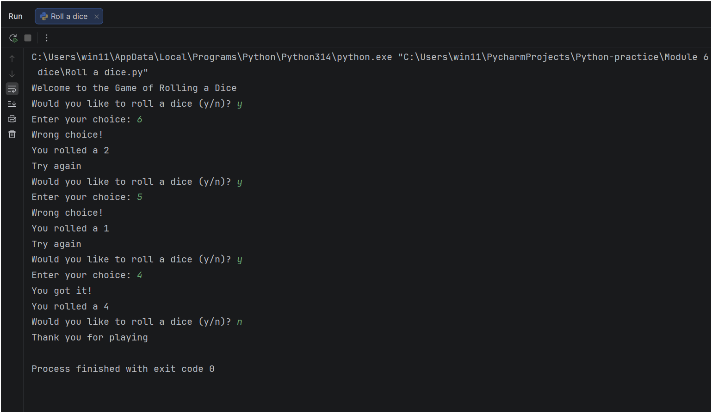

## Python Practice Question – Rolling a Dice Simulator

This folder contains a Python program that solves a **basic practice question** by building an interactive dice rolling game.

It is intended for beginners to strengthen their understanding of **core Python fundamentals** through simple problem-solving.

---

## 📌 Program Overview

The program in this folder covers the following practice concepts:

- Using an infinite `while` loop to maintain continuous program execution.
- Sanitizing user input using built-in string methods.
- Generating random integers simulating a standard 6-sided die using the `random` module.
- Implementing control flow (`if-elif-else`) and loop termination (`break`).

The program executes an interactive session, prompting the user for input and displaying the results clearly in the console.

---

## 🧪 Code Functionality

The program demonstrates:

### Loop and Control Flow
- **`while True:`**: Creates an infinite loop, allowing the game to run continuously until the user decides to quit.
- **`break`**: Exits the loop immediately when the user inputs 'n'.

### Input Handling
- **`lower()`**: Converts the user's string input to lowercase to ensure case-insensitive comparisons (e.g., treating 'Y' and 'y' the same).
- **`strip()`**: Removes any leading or trailing whitespace from the user's input to prevent accidental errors.

### Randomization
- **`random.randint(1, 6)`**: Generates a random integer between 1 and 6, mimicking a standard dice roll.

The program is written in a **simple and readable format**.

---

## 🖥️ Output

The program provides interactive feedback directly to the console during execution.  
The complete console output for this practice question is shown below.

---

## 📂 File Information

- `Roll a dice.py` — Contains the practice question program  
- `Output.png` — Screenshot of console output  
- `README.md` — Folder documentation  

---
## 👨‍💻 Author

**MD Shahnawaz Noor**     
*Aspiring Data Scientist* 
   
GitHub: [https://github.com/shahnawaznoor2020-code](https://github.com/shahnawaznoor2020-code)             
Email: shahnawaznoor2020@gmaIl.com  
 
---

## ⭐ Note

These practice programs help build a strong foundation in Python.  
They are essential before moving to functions and advanced logic.
