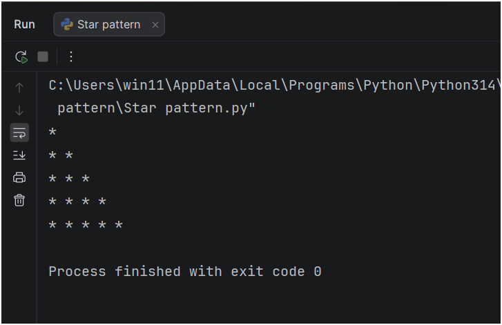

## Python Practice Question – Star Pattern (Nested Loops)

This folder contains a Python program that solves a **basic practice question** using nested loops to generate a classic right-angled triangle star pattern.

It is intended for beginners to strengthen their understanding of **core Python fundamentals** through simple problem-solving.

---

## 📌 Program Overview

The program in this folder covers the following practice concepts:

- Using nested `for` loops to create structured visual outputs.
- Controlling row and column iterations using the `range()` function.
- Formatting console output using the `end` parameter in the `print()` function.

The program executes the loop logic and displays the resulting star pattern clearly in the console.

---

## 🧪 Code Functionality

The program demonstrates:

### Nested Loops
- **Outer Loop (`for i in range(1, 6)`)**: Controls the total number of rows generated. In this case, it iterates 5 times to create a 5-row pattern.
- **Inner Loop (`for j in range(1, i + 1)`)**: Controls the number of elements (stars) printed on each specific row. The number of iterations dynamically increases depending on the current row number `i`.

### Print Mechanics
- **`print('*', end=' ')`**: Prints the asterisk character and replaces the default newline behavior with a single space, keeping the output on the same row.
- **Empty `print()`**: Called after the inner loop finishes to move the console cursor down to the next line for the subsequent row.

The program is written in a **simple and readable format**.

---

## 🖥️ Output

The program evaluates the loop conditions and prints the resulting star pattern directly to the console during execution.  
The complete console output for this practice question is shown below.

---

## 📂 File Information

- `Star pattern.py` — Contains the practice question program  
- `Output.png` — Screenshot of console output  
- `README.md` — Folder documentation  

---
## 👨‍💻 Author

**MD Shahnawaz Noor**     
*Aspiring Data Scientist* 
   
GitHub: [https://github.com/shahnawaznoor2020-code](https://github.com/shahnawaznoor2020-code)             
Email: shahnawaznoor2020@gmaIl.com  
 
---

## ⭐ Note

These practice programs help build a strong foundation in Python.  
They are essential before moving to functions and advanced logic.
