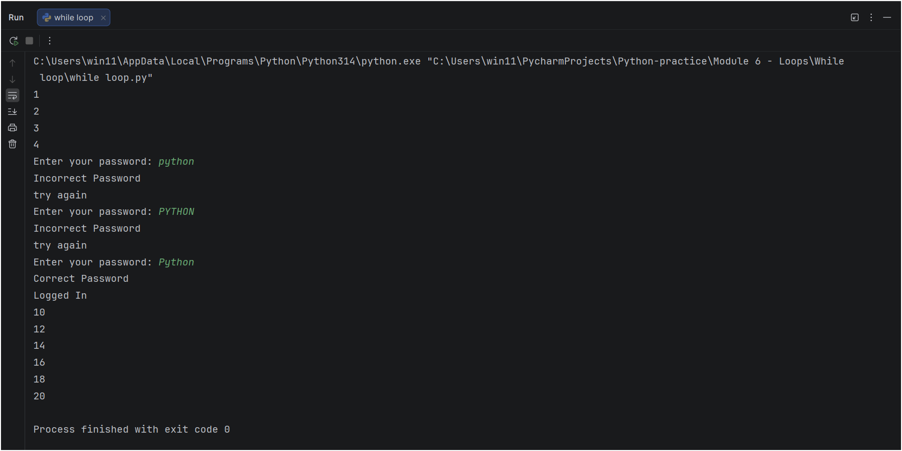

## Python Practice Question – While Loops

This folder contains a Python program that solves a **basic practice question** demonstrating the implementation of `while` loops for conditional iteration and user input validation.

It is intended for beginners to strengthen their understanding of **core Python fundamentals** through simple problem-solving.

---

## 📌 Program Overview

The program in this folder covers the following practice concepts:

- Utilizing a `while` loop to execute a block of code repeatedly as long as a condition is true.
- Managing loop iterations by properly updating control variables (e.g., incrementing a counter).
- Implementing an infinite loop (`while True:`) combined with conditional logic (`if/else`) and a `break` statement to build a basic password validation system (currently commented out in the source code).
- Iterating with custom step values.

The program executes predefined loops and displays the resulting numeric sequences clearly in the console.

---

## 🧪 Code Functionality

The program demonstrates:

### Basic While Loops
- **Condition-Based Loop**: Evaluates a condition (e.g., `num < 5` or `num <= 20`) before each iteration. The loop terminates when the condition evaluates to `False`.
- **Iteration Control**: Variables used in the loop condition must be modified within the loop body (e.g., `num = num + 1` or `num = num + 2`) to prevent infinite execution.

### Interactive Control (Commented Section)
- **`while True:`**: Creates a deliberate infinite loop that repeatedly prompts the user for input.
- **`break`**: Exits the infinite loop only when a specific success condition is met (e.g., the user inputs the correct password).

The program is written in a **simple and readable format**.

---

## 🖥️ Output

The program evaluates the active loops and prints the corresponding numbers directly to the console during execution.  
The complete console output for this practice question is shown below.

---

## 📂 File Information

- `while loop.py` — Contains the practice question program  
- `Output.png` — Screenshot of console output  
- `README.md` — Folder documentation  

---
## 👨‍💻 Author

**MD Shahnawaz Noor**     
*Aspiring Data Scientist* 
   
GitHub: [https://github.com/shahnawaznoor2020-code](https://github.com/shahnawaznoor2020-code)             
Email: shahnawaznoor2020@gmaIl.com  
 
---

## ⭐ Note

These practice programs help build a strong foundation in Python.  
They are essential before moving to functions and advanced logic.
