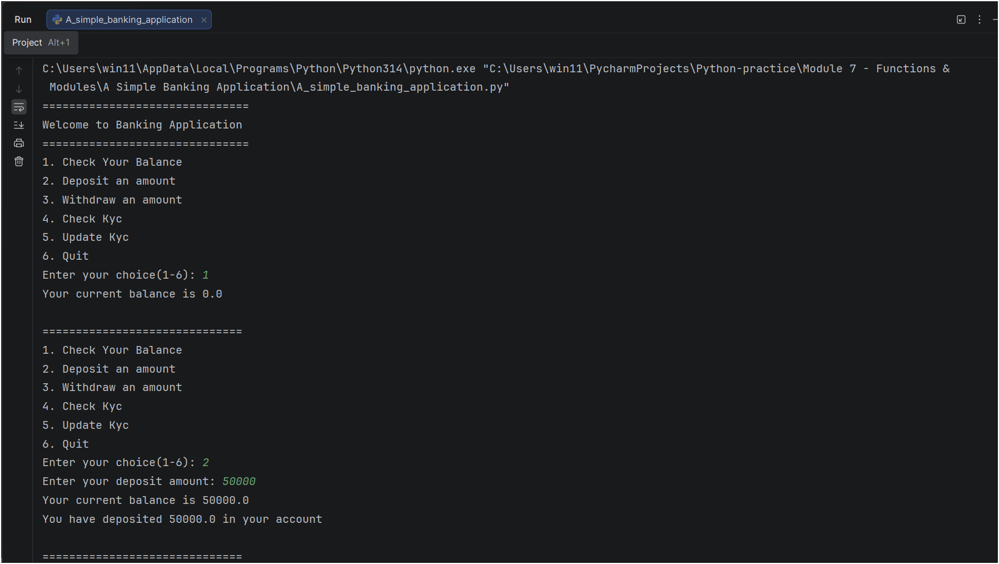
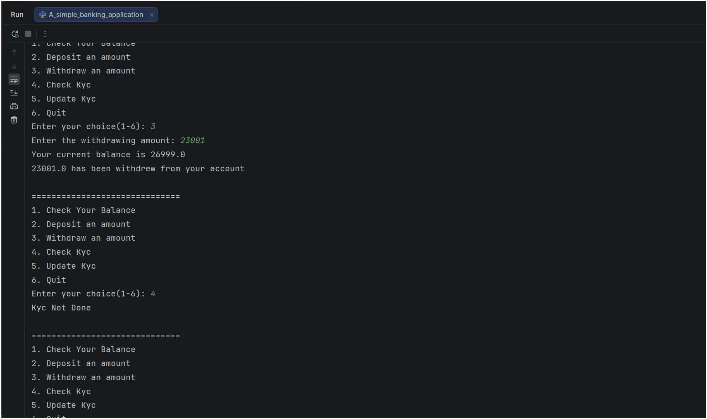

## Python Practice Question – Simple Banking Application

This folder contains a Python program that solves a **basic practice question** by building a command-line banking application. 

It is intended for beginners to strengthen their understanding of **core Python fundamentals**—specifically functions, global variables, loops, conditional statements, and dictionary manipulation—through simple problem-solving.

---

## 📌 Program Overview

The program simulates a basic banking environment with the following features:
- **Check Balance**: Displays the current account balance.
- **Deposit**: Allows the user to add funds, ensuring the amount is strictly positive.
- **Withdraw**: Allows the user to remove funds, checking for sufficient balance and valid amounts.
- **Check KYC**: Displays the user's uploaded KYC (Know Your Customer) documents.
- **Update KYC**: Allows the user to add or update multiple KYC documents (like PAN, Aadhaar) using a dictionary.
- **Interactive Menu**: Uses a continuous `while` loop to provide a menu-driven interface until the user chooses to quit.

---

## 🧪 Code Functionality

The program demonstrates several key Python concepts:

### Global Variables
- `balance` and `kyc_documents` are defined outside any function.
- The `global` keyword is used inside functions (`deposit`, `withdraw`, `update_kyc`, etc.) to modify these variables rather than creating local copies.

### Functions
Modularizes the code into distinct operations:
- `check_balance()`: Prints the balance.
- `deposit()`: Handles input validation and addition to the balance.
- `withdraw()`: Handles input validation, checks for sufficient funds, and subtracts from the balance.
- `check_kyc()`: Iterates through the dictionary to display stored documents.
- `update_kyc(docs)`: Takes a dictionary as an argument and merges it into the global KYC dictionary using the `.update()` method.

### Control Flow & Input Validation
- **`while True:`**: Creates an infinite loop to keep the application running until the user selects the 'Quit' option (`break`).
- **`if-elif-else`**: Used extensively to navigate the main menu and to validate deposit/withdrawal amounts (preventing negative deposits, overdrawing, etc.).

### Dictionary Operations
- KYC documents are stored as key-value pairs (e.g., `{'PAN': 'ABCDE1234F'}`).
- `kyc_documents.update(docs)` adds new entries or updates existing ones.

---

## 🖥️ Output

The program provides an interactive, menu-driven experience directly in the console.  
The complete console output demonstrating various features of this practice question is shown below.

---

## 📂 File Information

- `A_simple_banking_application.py` — Contains the practice question program  
- `Output_1.png` — Screenshot of console output (Part 1)  
- `Output_2.png` — Screenshot of console output (Part 2)  
- `README.md` — Folder documentation  

---
## 👨‍💻 Author

**MD Shahnawaz Noor**     
*Aspiring Data Scientist* 
   
GitHub: [https://github.com/shahnawaznoor2020-code](https://github.com/shahnawaznoor2020-code)             
Email: shahnawaznoor2020@gmaIl.com  
 
---

## ⭐ Note

These practice programs help build a strong foundation in Python.  
Building projects like this is essential before moving to object-oriented programming (OOP) and advanced software design.
