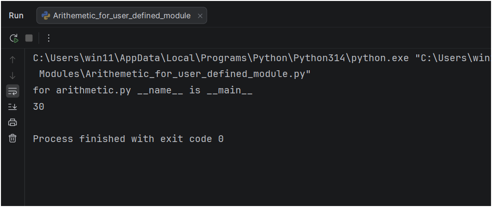

## Python Practice Question – Creating User-Defined Modules

This folder contains a Python program that solves a **basic practice question** demonstrating how to create, test, and utilize a user-defined module.

It is intended for beginners to strengthen their understanding of **core Python fundamentals**—specifically modular programming, functions, and the `__name__` variable—through simple problem-solving.

---

## 📌 Program Overview

The program in this folder covers the following practice concepts:

- Creating reusable mathematical functions (`add` and `squre_root`).
- Utilizing docstrings (`""" ... """`) for module documentation.
- Understanding the purpose of the special `__name__` variable.
- Implementing the `if __name__ == "__main__":` block to differentiate between running a script directly versus importing it as a module elsewhere.

The program executes the functions internally and displays testing output clearly in the console.

---

## 🧪 Code Functionality

The program demonstrates:

### Defining Functions
- **`def add(a, b):`**: A basic function that returns the sum of two parameters.
- **`def squre_root(a):`**: A function that calculates the square root by raising a number to the power of 0.5.

### The `__name__` Variable and Execution Control
- Python automatically sets the `__name__` variable for every script. 
- If a script is run directly by the user, Python sets `__name__` to `"__main__"`. 
- If the script is imported by another Python file, `__name__` is set to the name of the file (e.g., `"Arithemetic_for_user_defined_module"`).
- **`if __name__ == "__main__":`**: Code placed inside this block will *only* execute if the file is run directly. This is best practice for adding test code (like defining `a=10`, `b=20`, and printing the result) without having that test code automatically run when the module is imported into a larger project.

The program is written in a **simple and readable format**.

---

## 🖥️ Output

The program prints the value of `__name__` and the result of the test addition directly to the console during execution.  
The complete console output for this practice question is shown below.

---

## 📂 File Information

- `Arithemetic_for_user_defined_module.py` — Contains the user-defined module program  
- `Output.png` — Screenshot of console output  
- `README.md` — Folder documentation  

---
## 👨‍💻 Author

**MD Shahnawaz Noor**     
*Aspiring Data Scientist* 
   
GitHub: [https://github.com/shahnawaznoor2020-code](https://github.com/shahnawaznoor2020-code)             
Email: shahnawaznoor2020@gmaIl.com  
 
---

## ⭐ Note

These practice programs help build a strong foundation in Python.  
Understanding modules is essential before moving to larger projects and object-oriented programming (OOP).
