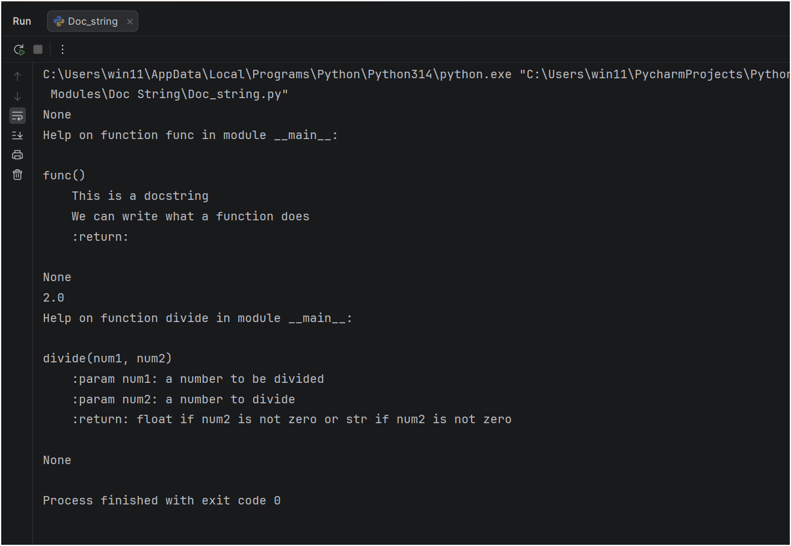

## Python Practice Question – Docstrings and the `help()` Function

This folder contains a Python program that solves a **basic practice question** demonstrating how to properly document functions using docstrings and how to access that documentation programmatically.

It is intended for beginners to strengthen their understanding of **core Python fundamentals**—specifically code readability and documentation best practices—through simple examples.

---

## 📌 Program Overview

The program in this folder covers the following practice concepts:

- Writing docstrings to explain what a function does.
- Documenting expected parameters (`:param:`) and return values (`:return:`).
- Using Python's built-in `help()` function to read a function's documentation.
- Implementing basic conditional logic inside a function to handle edge cases (like dividing by zero).

The program executes the functions and their help commands, displaying both the computed results and the documentation clearly in the console.

---

## 🧪 Code Functionality

The program demonstrates:

### Docstrings
- **`""" ... """`**: A multi-line string placed directly beneath a function definition. Python recognizes this specific placement as the official documentation for that function. It is used to describe the function's purpose, arguments, and return types, making the code much easier for others (or yourself later) to understand.

### Built-in Functions
- **`help(function_name)`**: A built-in Python function that retrieves and prints the docstring of the specified function, class, or module. In this script, `help(func)` and `help(divide)` are used to output the exact text written inside their respective docstrings.

### Error Handling Logic
- The `divide` function includes an `if num2 == 0:` check to gracefully return a warning string instead of crashing the program with a `ZeroDivisionError`.

The program is written in a **simple and readable format**.

---

## 🖥️ Output

The program evaluates the functions and prints both the return values and the requested documentation directly to the console during execution.  
The complete console output for this practice question is shown below.

---

## 📂 File Information

- `Doc_string.py` — Contains the practice question program  
- `Output.png` — Screenshot of console output  
- `README.md` — Folder documentation  

---
## 👨‍💻 Author

**MD Shahnawaz Noor**     
*Aspiring Data Scientist* 
   
GitHub: [https://github.com/shahnawaznoor2020-code](https://github.com/shahnawaznoor2020-code)             
Email: shahnawaznoor2020@gmaIl.com  
 
---

## ⭐ Note

These practice programs help build a strong foundation in Python.  
Writing good docstrings is an essential industry best practice before moving on to building larger, collaborative software projects.