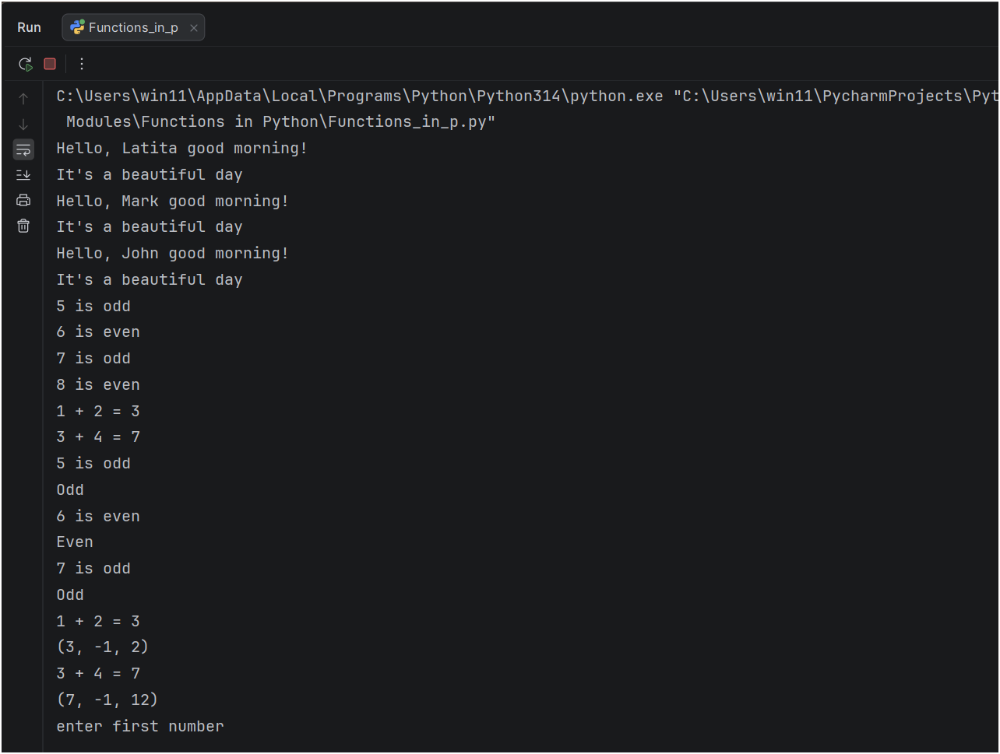
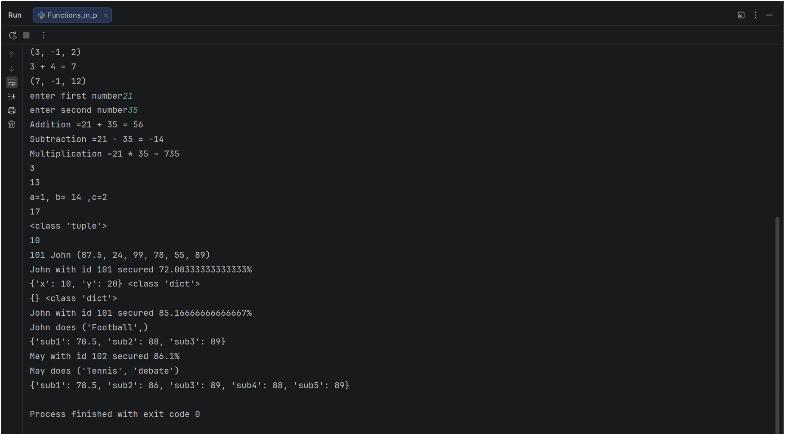

## Python Practice Question – Functions

This folder contains a Python program that solves a **basic practice question** demonstrating the concept, creation, and usage of functions in Python.

It is intended for beginners to strengthen their understanding of **core Python fundamentals** through simple problem-solving.

---

## 📌 Program Overview

The program in this folder covers the following practice concepts:

- Defining basic functions using the `def` keyword.
- Passing arguments (parameters) into functions to make them dynamic.
- Using the `return` statement to send computed values back to the caller (including returning multiple values).
- Exploring different types of function arguments:
  - **Positional Arguments**: Standard arguments passed in the correct order.
  - **Default Arguments**: Parameters with predefined values.
  - **Keyword Arguments**: Arguments passed explicitly by name.
  - **Variable-Length Arguments (`*args`)**: Accepting an arbitrary number of positional arguments as a tuple.
  - **Variable-Length Keyword Arguments (`**kwargs`)**: Accepting an arbitrary number of keyword arguments as a dictionary.

The program executes various function calls and displays the resulting calculations and string formatting clearly in the console.

---

## 🧪 Code Functionality

The program demonstrates several function styles:

### Standard Functions
- **`greeting(name)`**: A simple function that takes a string argument and prints a formatted message.
- **`even_odd(num)`**: Includes conditional logic (`if/else`) to determine parity and returns a string result.

### Returning Multiple Values
- **`add(num1, num2)`** & **`arithmetic(num1, num2)`**: These functions perform multiple operations (addition, subtraction, multiplication) and return the results as a tuple, which is then unpacked by the caller.

### Advanced Arguments
- **`addd(num1, num2=10)`**: Shows how `num2` defaults to 10 if a second argument isn't provided.
- **`addi(*args)`**: Uses `*args` to take any number of integers and returns their total sum.
- **`students_details(sidd, ssname, *extra, **markss)`**: A complex function demonstrating the integration of standard parameters, `*args` (for extra activities), and `**kwargs` (for an arbitrary number of subject marks).

The program is written in a **simple and readable format**.

---

## 🖥️ Output

The program evaluates the functions and prints the results directly to the console during execution.  
The complete console output for this practice question is shown below.

---

## 📂 File Information

- `Functions_in_p.py` — Contains the practice question program  
- `Output_1.png` — Screenshot of console output (Part 1)  
- `Output_2.png` — Screenshot of console output (Part 2)  
- `README.md` — Folder documentation  

---
## 👨‍💻 Author

**MD Shahnawaz Noor**     
*Aspiring Data Scientist* 
   
GitHub: [https://github.com/shahnawaznoor2020-code](https://github.com/shahnawaznoor2020-code)             
Email: shahnawaznoor2020@gmaIl.com  
 
---

## ⭐ Note

These practice programs help build a strong foundation in Python.  
Mastering functions is essential before moving to object-oriented programming (OOP) and advanced logic.
