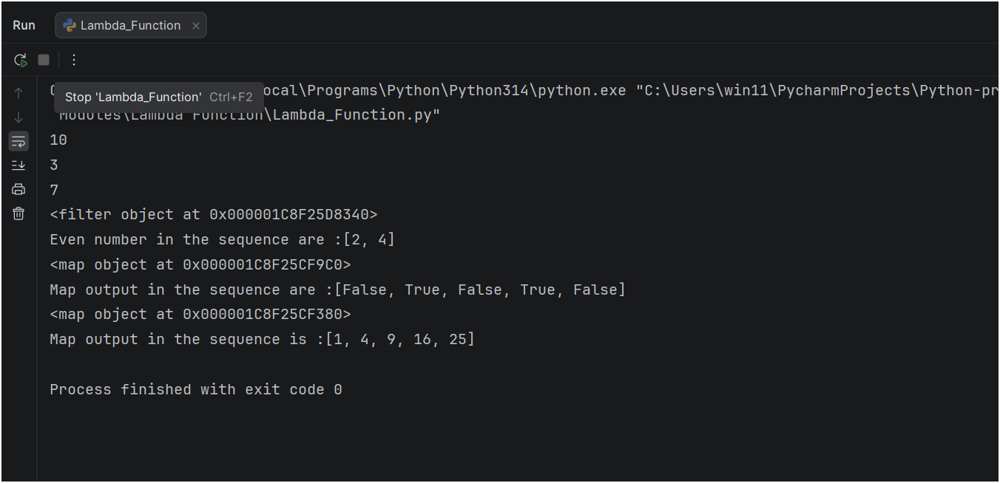

## Python Practice Question – Lambda, Filter, and Map

This folder contains a Python program that solves a **basic practice question** demonstrating the use of anonymous `lambda` functions and built-in higher-order functions like `filter()` and `map()`.

It is intended for beginners to strengthen their understanding of **core Python fundamentals** through simple problem-solving.

---

## 📌 Program Overview

The program in this folder covers the following practice concepts:

- Creating anonymous, single-line functions using the `lambda` keyword.
- Assigning a lambda function to a variable to call it later.
- Using the `filter()` function to extract elements from a sequence that satisfy a specific condition.
- Using the `map()` function to apply a transformation to every element in a sequence.

The program executes predefined lambda operations and higher-order functions, displaying the resulting lists clearly in the console.

---

## 🧪 Code Functionality

The program demonstrates:

### Lambda Functions
- **`lambda args: expression`**: A concise way to create small, unnamed functions. In this program, lambda functions are used for basic arithmetic (e.g., `lambda a, b: a + b`) and for conditional logic (e.g., `lambda x: True if x % 2 == 0 else False`).

### Higher-Order Functions
- **`filter(function, iterable)`**: Constructs an iterator from elements of the `iterable` for which the `function` returns `True`. Used here to filter out odd numbers from a list.
- **`map(function, iterable)`**: Applies the given `function` to every item of the `iterable` and yields the results. Used here to map the boolean results of the even/odd check, and to square every number in a list (`lambda x: x**2`).

The program is written in a **simple and readable format**.

---

## 🖥️ Output

The program evaluates the functions and prints the results directly to the console during execution. Note that `map` and `filter` return iterator objects, which are converted to lists using `list()` for display.  
The complete console output for this practice question is shown below.

---

## 📂 File Information

- `Lambda_Function.py` — Contains the practice question program  
- `Output.png` — Screenshot of console output  
- `README.md` — Folder documentation  

---
## 👨‍💻 Author

**MD Shahnawaz Noor**     
*Aspiring Data Scientist* 
   
GitHub: [https://github.com/shahnawaznoor2020-code](https://github.com/shahnawaznoor2020-code)             
Email: shahnawaznoor2020@gmaIl.com  
 
---

## ⭐ Note

These practice programs help build a strong foundation in Python.  
They are essential before moving to functions and advanced logic.
