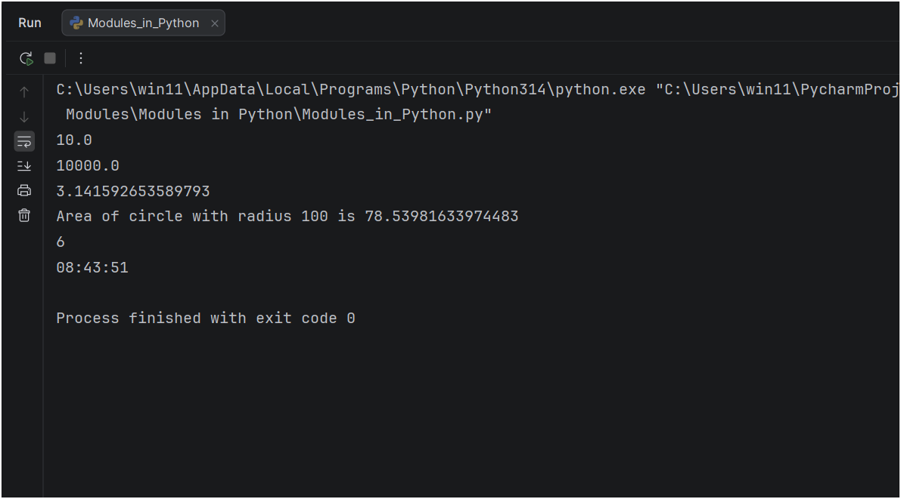

## Python Practice Question – Modules in Python

This folder contains a Python program that solves a **basic practice question** demonstrating how to import and utilize built-in modules in Python.

It is intended for beginners to strengthen their understanding of **core Python fundamentals** through simple problem-solving.

---

## 📌 Program Overview

The program in this folder covers the following practice concepts:

- Understanding that any `.py` file is fundamentally a module.
- Importing entire built-in modules (e.g., `math`).
- Importing specific functions or variables from a module to save memory and shorten code (e.g., `from random import randint`).
- Creating aliases for imported modules to improve code readability and typing speed (e.g., `import datetime as dt`).

The program executes predefined mathematical, random, and datetime operations, displaying the results clearly in the console.

---

## 🧪 Code Functionality

The program demonstrates:

### Full Module Import (`import math`)
- **`math.sqrt(num)`**: Calculates the square root of a number.
- **`math.pow(num, 2)`**: Calculates a number raised to the power of 2.
- **`math.pi`**: Accesses the mathematical constant Pi (π) to calculate the area of a circle.

### Specific Import (`from random import randint`)
- By importing only `randint`, the code can call it directly as `randint(1, 6)` instead of the longer `random.randint(1, 6)`. Used here to simulate a dice roll.

### Alias Import (`import datetime as dt`)
- Renames the module within the scope of the script. The script then creates a time object using `dt.time(8, 43, 51)`.

The program is written in a **simple and readable format**.

---

## 🖥️ Output

The program evaluates the module functions and prints the results directly to the console during execution.  
The complete console output for this practice question is shown below.

---

## 📂 File Information

- `Modules_in_Python.py` — Contains the practice question program  
- `Output.png` — Screenshot of console output  
- `README.md` — Folder documentation  

---
## 👨‍💻 Author

**MD Shahnawaz Noor**     
*Aspiring Data Scientist* 
   
GitHub: [https://github.com/shahnawaznoor2020-code](https://github.com/shahnawaznoor2020-code)             
Email: shahnawaznoor2020@gmaIl.com  
 
---

## ⭐ Note

These practice programs help build a strong foundation in Python.  
Understanding how to leverage existing modules is essential before moving to object-oriented programming (OOP) and advanced logic.
