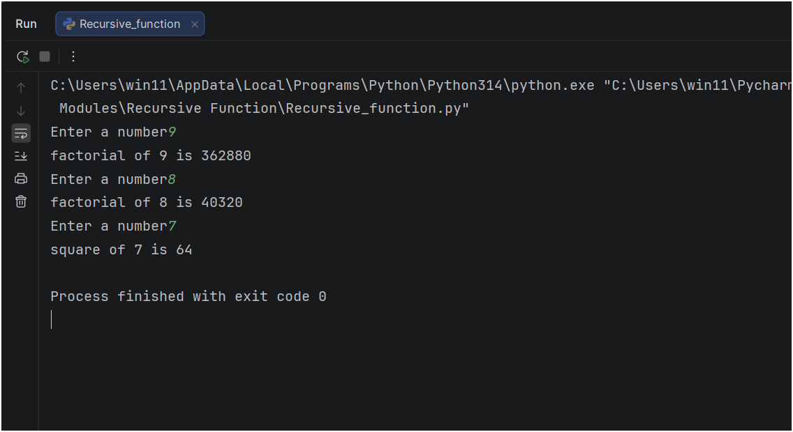

## Python Practice Question – Recursive Functions and Function Arguments

This folder contains a Python program that solves a **basic practice question** demonstrating the concept of recursion and how to pass functions as arguments in Python.

It is intended for beginners to strengthen their understanding of **core Python fundamentals** through simple problem-solving.

---

## 📌 Program Overview

The program in this folder covers the following practice concepts:

- Calculating the factorial of a number using an iterative approach (`while` loop).
- Understanding the structure of a **recursive function** (Base/Terminal condition and Recursive call).
- Calculating the factorial of a number using a recursive approach.
- Passing the output of one function directly as an argument into another function (function composition).

The program executes predefined logic based on user input, displaying the calculated factorials and squared results clearly in the console.

---

## 🧪 Code Functionality

The program demonstrates:

### Iteration vs. Recursion
- **Iterative Factorial (`factorial(n)`)**: Uses a `while` loop to multiply `n` by decreasing values until `n` reaches 1.
- **Recursive Factorial (`fact(num)`)**: 
  - *Base Condition*: `if num == 1: return 1` (Stops the recursion).
  - *Recursive Call*: `return num * fact(num-1)` (The function calls itself with a smaller argument).

### Function Composition
- **Passing Functions**: Demonstrates passing the result of `add_1(num)` directly into the `square(num)` function (e.g., `square(add_1(num))`).

The program is written in a **simple and readable format**.

---

## 🖥️ Output

The program prompts the user for numeric input and prints the mathematical results directly to the console during execution.  
The complete console output for this practice question is shown below.

---

## 📂 File Information

- `Recursive_function.py` — Contains the practice question program  
- `Output.png` — Screenshot of console output  
- `README.md` — Folder documentation  

---
## 👨‍💻 Author

**MD Shahnawaz Noor**     
*Aspiring Data Scientist* 
   
GitHub: [https://github.com/shahnawaznoor2020-code](https://github.com/shahnawaznoor2020-code)             
Email: shahnawaznoor2020@gmaIl.com  
 
---

## ⭐ Note

These practice programs help build a strong foundation in Python.  
Understanding recursion is essential before moving to advanced algorithms and object-oriented programming (OOP).
