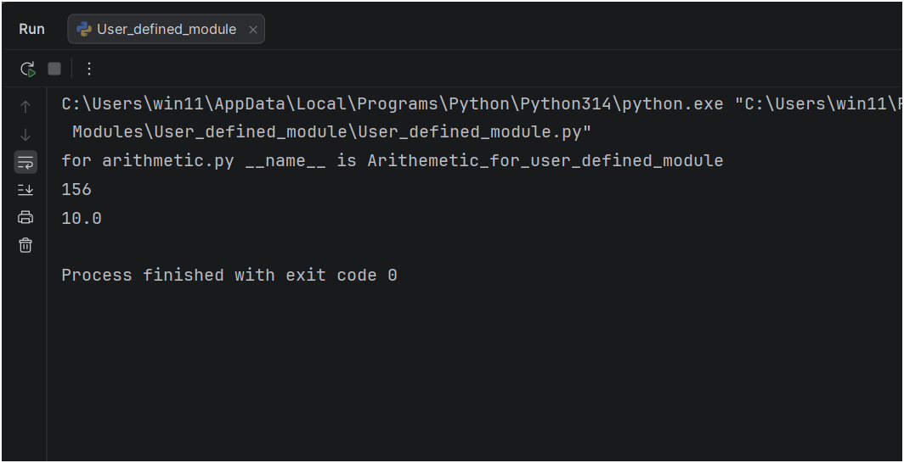

## Python Practice Question – Importing User-Defined Modules

This folder contains a Python program that solves a **basic practice question** demonstrating how to import and utilize a custom user-defined module in another Python script.

It is intended for beginners to strengthen their understanding of **core Python fundamentals**—specifically modular programming and script organization—through simple problem-solving.

---

## 📌 Program Overview

The program in this folder covers the following practice concepts:

- Separating code logic into multiple files for better organization and reusability.
- Importing a custom module located in the same directory.
- Using an alias (`as`) to shorten the module name during import.
- Calling functions defined in an external custom module.

The program executes the imported functions and displays the resulting calculations clearly in the console.

---

## 🧪 Code Functionality

The program demonstrates two interconnected files:

### 1. The Custom Module (`Arithemetic_for_user_defined_module.py`)
- Defines standard, reusable functions like `add(a, b)` and `squre_root(a)`.
- Implements the `if __name__ == "__main__":` block to ensure its internal testing code does not execute when the module is imported elsewhere.

### 2. The Main Script (`User_defined_module.py`)
- **`import Arithemetic_for_user_defined_module as ar`**: Imports the custom module and assigns it a shorthand alias (`ar`).
- **Function Calling**: Accesses the module's functions using dot notation (e.g., `ar.add(a, b)` and `ar.squre_root(a)`).

The program is written in a **simple and readable format**.

---

## 🖥️ Output

The program evaluates the functions from the custom module and prints the results directly to the console during execution.  
The complete console output for this practice question is shown below.

---

## 📂 File Information

- `Arithemetic_for_user_defined_module.py` — The custom module containing mathematical functions
- `User_defined_module.py` — The main script that imports and executes the module
- `Output.png` — Screenshot of console output  
- `README.md` — Folder documentation  

---
## 👨‍💻 Author

**MD Shahnawaz Noor**     
*Aspiring Data Scientist* 
   
GitHub: [https://github.com/shahnawaznoor2020-code](https://github.com/shahnawaznoor2020-code)             
Email: shahnawaznoor2020@gmaIl.com  
 
---

## ⭐ Note

These practice programs help build a strong foundation in Python.  
Understanding how to connect multiple files is essential before moving to larger applications and framework development.
