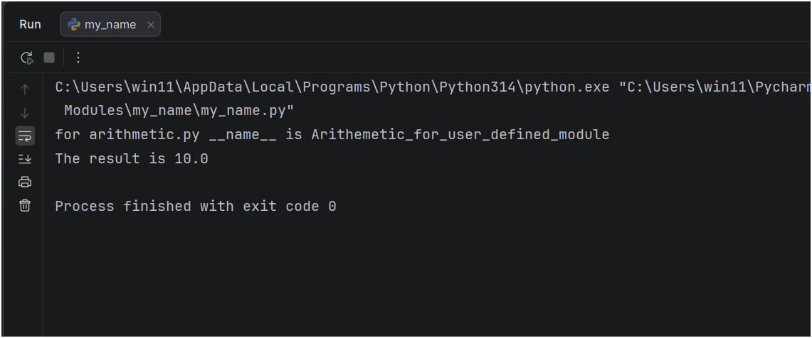

## Python Practice Question – The `__name__` Variable

This folder contains a Python program that solves a **basic practice question** demonstrating how Python assigns the special `__name__` variable when a script is executed directly versus when it is imported as a module.

It is intended for beginners to strengthen their understanding of **core Python fundamentals**—specifically script execution and module management—through simple problem-solving.

---

## 📌 Program Overview

The program in this folder covers the following practice concepts:

- Importing a custom module into a main script.
- Understanding how Python's built-in `__name__` variable behaves.
- Observing the difference in `__name__` values: `__main__` for the directly executed script, and the actual module's name for imported files.
- Utilizing the `if __name__ == "__main__":` block to prevent testing code inside a module from running when imported.

The program executes the main script and displays the contextual values of the `__name__` variable clearly in the console.

---

## 🧪 Code Functionality

The program demonstrates the interaction between two files:

### 1. The Custom Module (`Arithemetic_for_user_defined_module.py`)
- Contains mathematical functions (`add`, `squre_root`).
- Includes a global print statement: `print(f"for arithmetic.py __name__ is {__name__}")`. When imported, this prints the module's name instead of `__main__`.
- The code inside its `if __name__ == "__main__":` block is ignored because it is being imported, not run directly.

### 2. The Main Script (`my_name.py`)
- Imports the custom module using an alias (`import Arithemetic_for_user_defined_module as ar`).
- During the import, the module's global print statement executes, revealing its assigned `__name__`.
- Calls the `squre_root()` function from the imported module and prints the result.
- Because `my_name.py` is the script being run directly by the user, its internal `__name__` variable evaluates to `"__main__"`.

The program is written in a **simple and readable format**.

---

## 🖥️ Output

The program evaluates the variable contexts and prints the results directly to the console during execution.  
The complete console output for this practice question is shown below.

---

## 📂 File Information

- `my_name.py` — The main script being executed
- `Arithemetic_for_user_defined_module.py` — The custom module being imported
- `Output.png` — Screenshot of console output  
- `README.md` — Folder documentation  

---
## 👨‍💻 Author

**MD Shahnawaz Noor**     
*Aspiring Data Scientist* 
   
GitHub: [https://github.com/shahnawaznoor2020-code](https://github.com/shahnawaznoor2020-code)             
Email: shahnawaznoor2020@gmaIl.com  
 
---

## ⭐ Note

These practice programs help build a strong foundation in Python.  
Understanding the `__name__` variable is crucial for writing clean, reusable, and testable modules.